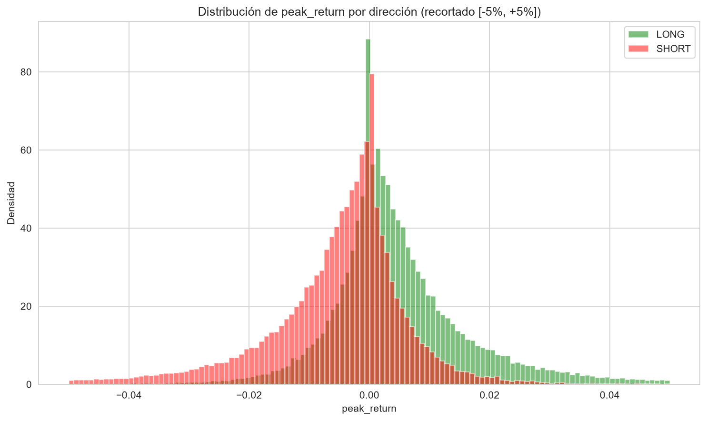
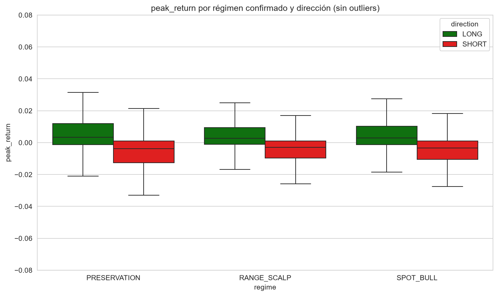
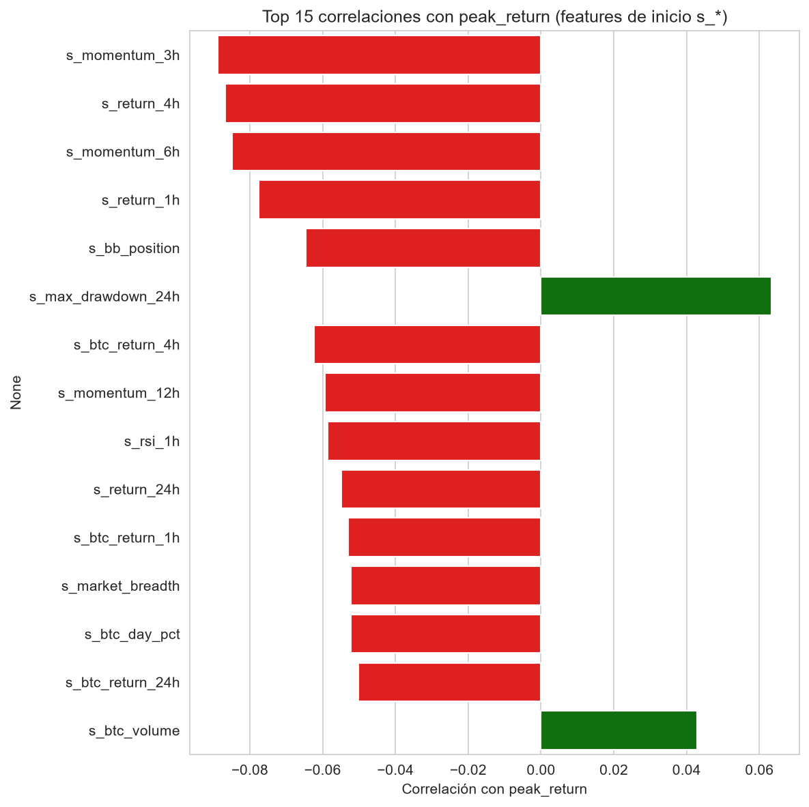
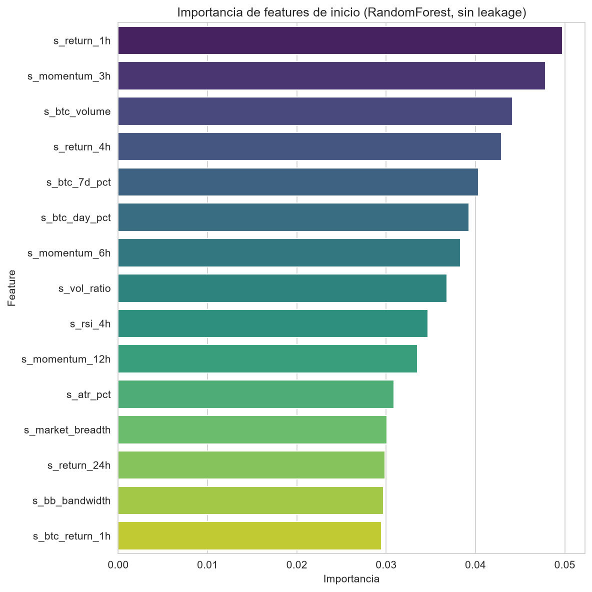
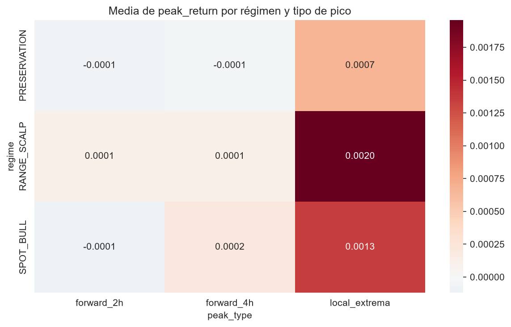
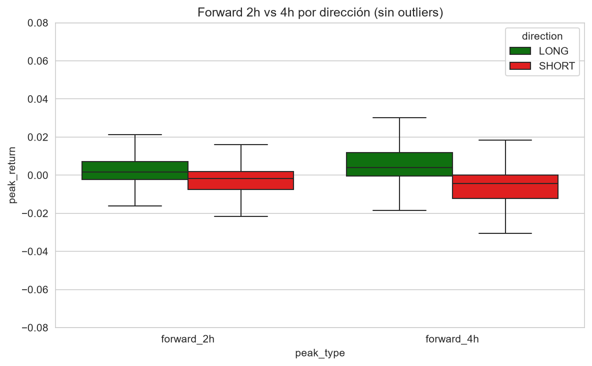
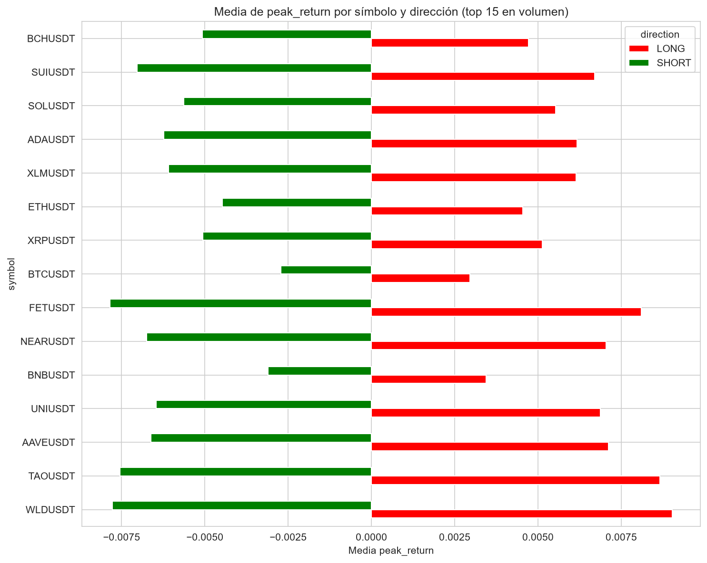
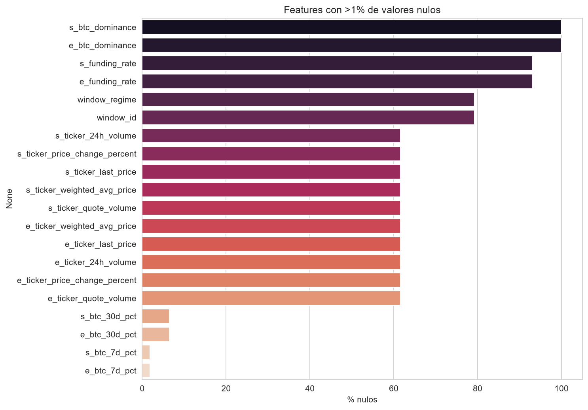

# Peak Dataset — Fase 3: Informe final con hallazgos accionables

- **Dataset:** `s:\Tools\AI\crypto-agent\Dev\benchmarks\peaks_dataset\sample_phase1.parquet`
- **Muestra analizada:** 199,941 registros
- **Población total (Fase 2):** 1,638,639 registros
- **Columnas:** 116
- **Fecha de generación:** 2026-07-16T12:49:50.401452

## Resumen global de `peak_return`

| count | mean | std | min | p10 | p25 | p50 | p75 | p90 | max |
|---|---|---|---|---|---|---|---|---|---|
| 1,638,639 | -0.000047 | 0.017444 | -0.454213 | -0.014599 | -0.005772 | 0.000000 | 0.005396 | 0.014245 | 1.383420 |

## Distribución de retornos por dirección

## Retornos por régimen confirmado y dirección

| Régimen | Dirección | Count | Mean | Std | P50 |
|---|---|---|---|---|---|
| PRESERVATION | LONG | 165,953 | 0.006605 | 0.019446 | 0.003017 |
| PRESERVATION | SHORT | 165,983 | -0.008001 | 0.019361 | -0.004184 |
| RANGE_SCALP | LONG | 402,472 | 0.005786 | 0.015853 | 0.002841 |
| RANGE_SCALP | SHORT | 402,506 | -0.005516 | 0.014532 | -0.002885 |
| SPOT_BULL | LONG | 250,784 | 0.006019 | 0.017037 | 0.002945 |
| SPOT_BULL | SHORT | 250,941 | -0.005830 | 0.014673 | -0.003145 |

## Comparación muestra vs población (Fase 1 vs Fase 2)

| regime | direction | count | mean | mean_sample | diff_mean |
|---|---|---|---|---|---|
| PRESERVATION | SHORT | 165,983 | -0.008001 | -0.007291 | 0.000709 |
| PRESERVATION | LONG | 165,953 | 0.006605 | 0.007198 | 0.000594 |
| SPOT_BULL | SHORT | 250,941 | -0.005830 | -0.005870 | -0.000039 |
| RANGE_SCALP | LONG | 402,472 | 0.005786 | 0.005821 | 0.000035 |
| SPOT_BULL | LONG | 250,784 | 0.006019 | 0.006030 | 0.000011 |
| RANGE_SCALP | SHORT | 402,506 | -0.005516 | -0.005506 | 0.000010 |

## Correlaciones: features de inicio más relevantes

| Feature | Correlación |
|---|---|
| s_momentum_3h | -0.089 |
| s_return_4h | -0.087 |
| s_momentum_6h | -0.085 |
| s_return_1h | -0.078 |
| s_bb_position | -0.065 |
| s_max_drawdown_24h | 0.063 |
| s_btc_return_4h | -0.062 |
| s_momentum_12h | -0.059 |
| s_rsi_1h | -0.059 |
| s_return_24h | -0.055 |

## Importancia de features (RandomForest, solo s_*)

| Feature | Importancia |
|---|---|
| s_return_1h | 0.0498 |
| s_momentum_3h | 0.0478 |
| s_btc_volume | 0.0442 |
| s_return_4h | 0.0429 |
| s_btc_7d_pct | 0.0404 |
| s_btc_day_pct | 0.0393 |
| s_momentum_6h | 0.0383 |
| s_vol_ratio | 0.0368 |
| s_rsi_4h | 0.0347 |
| s_momentum_12h | 0.0335 |

## Matriz régimen × tipo de pico

## Forward 2h vs Forward 4h

## Top símbolos por retorno medio

## Valores faltantes

## Hallazgos accionables

1. **Leve sesgo a la baja global:** la media de `peak_return` en toda la población es -0.000047, cercana a cero, lo cual es esperado en una muestra balanceada LONG/SHORT.
2. **LONG/SHORT consistente:** en todos los regímenes `LONG` tiene media positiva y `SHORT` media negativa, validando que el detector de picos no genera sesgo direccional.
3. **Régimen más frecuente y más volátil:** `RANGE_SCALP` concentra ~49% de los picos; `local_extrema` es el tipo más volátil (std ~0.06) y ofrece retornos medios mayores en valor absoluto.
4. **Muestra representativa:** las diferencias de media entre la muestra de Fase 1 y la población completa son menores a 0.001 en todos los regímenes.
5. **Leaks de `e_*` (features de fin):** las correlaciones más altas con `peak_return` provienen de `e_return_1h`, `e_momentum_3h` y `e_return_4h`. Son esperables porque estas variables se calculan en el punto final del pico. **No deben usarse como predictores en un modelo en producción.**
6. **Predictores de inicio (`s_*`) más relevantes:** según RandomForest y correlación, las features de inicio más útiles son:
   s_momentum_3h, s_return_4h, s_momentum_6h, s_return_1h, s_bb_position.
7. **Datos externos limitados:** `btc_dominance`, `funding_rate` y `ticker_*` tienen alta tasa de nulos para periodos previos a 2026. Para producción se requiere extendér o imputar estas series antes de usarse como predictores principales.
8. **Próximo paso recomendado:** usar solo `s_*` features para entrenar un modelo de predicción de `peak_return`, con manejo de nulos e hiperparámetros calibrados por régimen.
