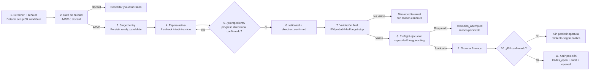

## Arquitectura canónica de calibración de entrada

### Regla permanente: Kelly agresivo no-regresivo

- La recalibración del sistema está permitida y es deseable, pero **no** puede degradar Kelly por debajo del baseline agresivo canónico.
- Pisos mínimos obligatorios (SPOT/FUTURES):
  - `kelly_base_usdt >= 150`
  - `kelly_max_usdt >= 1000`
  - `kelly_max_pct_liquid >= 0.90`
  - `kelly_dynamic_base_pct >= 0.18`
  - `kelly_conviction_max_pct >= 0.22`
  - `futures_kelly_base_usdt >= 200`
  - `futures_kelly_max_usdt >= 2500`
  - `futures_kelly_cap_pct >= 0.90`
  - `futures_kelly_max_pct_liquid >= 0.90`
- Cualquier endpoint de aplicación de configuración, carga de overrides desde DB o activación de perfiles debe respetar estos pisos.
- El objetivo de la recalibración es optimizar selección, timing y calidad de entrada/salida, no reducir la capacidad de capitalización por sizing conservador.

### Actualización operativa (s121, 2026-08-07) - calibración SR ganadora aplicada

Se aplicó en runtime y en defaults de código la configuración ganadora de la última ronda de simulaciones SR, con snapshot y restart controlado.

- Configuración aplicada (spot, señal y riesgo):
  - `min_signal_strength = 0.45`
  - `min_success_probability = 0.45`
  - `stop_loss_pct = 2.5`
  - `kelly_max_usdt = 1000.0`
  - `kelly_dynamic_base_pct = 0.18`
  - `max_positions_spot_bull = 8`
- Trazabilidad de cambio:
  - Snapshot pre-restart: `20260807_145135_059092`
  - Apply runtime: `POST /mimic/apply-recommendation` (`ok=true`, sin rechazados)
  - Restart operativo: contenedor `crypto-agent-app` reiniciado y validado post-boot.
- Verificación post-restart:
  - `/config/kelly` reporta los valores anteriores en `db_overrides`.
  - `/metrics/shadow-readiness` operativo tras restart.

### Actualización operativa (s128, 2026-08-08) - recertificación bidireccional SR pre-open + IDs visibles

Se implementó una recertificación final, justo antes de autorizar apertura (`risk queue`), para evitar desalineaciones tardías entre tesis SR y precio observado.

- Cobertura bidireccional en todos los modos (`SPOT_BULL`, `RANGE_SCALP`, `FUTURES_SHORT`, `PRESERVATION`):
  - `LONG` debe permanecer cerca de soporte.
  - `SHORT` debe permanecer cerca de resistencia.
- Excepciones inteligentes para no cortar aperturas legítimas:
  - Se permite bypass por breakout/breakdown confirmado con presión SR suficiente.
  - Se limita distancia máxima del breakout para evitar entrar cuando el movimiento ya está demasiado extendido.
- Anti-overblocking por diseño:
  - Modo por régimen (`sr_side_guard_mode`) con `active_canary` o `enforced`.
  - Si falta metadata SR (nivel/precio), el guard funciona en fail-open para no frenar todo el flujo.
  - Un bloqueo por SR-side no descarta el candidato: lo mantiene `validated` en monitoreo (`SR_SIDE_GUARD_WAIT`).
- Observabilidad:
  - Persistencia de `sr_side_guard_last` y check de lifecycle `SR_SIDE_GUARD_BLOCKED` cuando aplica bloqueo real.
- Dashboard:
  - Se expone ID visible y corto por fila (`position_display_id`) en abiertas y cerradas para rastreo rápido.

```mermaid
flowchart TD
  A[market_regime.py\nDetecta modo activo] --> B[run_trades.py\nOrquestación de ciclo]
  B --> C[pair_screener.py\nUniverso elegible]
  C --> D[autonomous_signals.py\nSeñal + features técnicas]
  D --> D1[support_resistance.py\nSetup SR: bounce/breakout/breakdown]
  D --> F[external_data_client.py\nDatos externos C9]
  D --> G[technical_graph_analyst.py\nFeatures OHLC C10]
  D1 --> E[entry_profile_gate.py\nClasifica A/B/C o discard]
  E --> H[portfolio_selector.py\nSelección (QUBO)]
  H --> I[staged_entry.py\nCandidato en espera: ready]
  I --> I1[Checks inter/intra ciclo\nEspera rompimiento/progreso direccional]
  I1 -->|No confirma| I
  I1 -->|Confirma| I2[validated + direction_confirmed]
  I2 --> J[pnl_service.py + entry_decision.py\nEV/probabilidad/target-stop]
  J --> K[run_trades.py\nPreflight + gates finales]
  K --> L[(Binance fill confirmado)]
  L --> M[(PostgreSQL\ntrades_open + trades_audit + ready_* opened)]
  N[analysis_cycle.py\nParaleliza análisis C8] --> D
  O[app.py\nEndpoints + hot-config + observabilidad] --> B
  O --> I
```

### Descripción de módulos de calibración de entrada

| Módulo | Función en calibración | Salida principal |
|---|---|---|
| `market_regime.py` | Determina régimen activo (`SPOT_BULL`, `RANGE_SCALP`, `PRESERVATION`, `FUTURES_SHORT`) y multiplicadores de contexto. | `MarketRegime` confirmado para gating y sizing. |
| `run_trades.py` | Orquesta el pipeline de entrada, aplica gates, enruta side/venue y ejecuta apertura. | Orden confirmada + persistencia en `trades_open`/`trades_audit`. |
| `pair_screener.py` | Recorta universo por liquidez, calidad y reglas de régimen. | Lista de símbolos candidatos por ciclo. |
| `autonomous_signals.py` | Calcula señales técnicas, fuerza, features SR y señales por símbolo. | Payload de señal normalizado para gate y ranking. |
| `entry_profile_gate.py` | Evalúa calidad de entrada (A/B/C/discard) con umbrales y modelo. | Perfil de entrada + score de calidad. |
| `portfolio_selector.py` | Selección final de candidatos bajo capacidad/diversificación. | Candidatos priorizados (`top_symbols_qubo`). |
| `staged_entry.py` | Lifecycle de candidatos (`ready`, `validated`, `opened`, `discarded`) y espera activa de confirmación direccional/rompimiento SR antes de abrir. | Cola de apertura trazable por `ready_candidate_id` + estado de confirmación. |
| `pnl_service.py` / `entry_decision.py` | Valida probabilidad, EV, target/stop y elegibilidad final de orden. | `is_valid`, `expected_pnl`, razones de aceptación/rechazo. |
| `analysis_cycle.py` | Refresca análisis técnico en background con ejecución paralela (C8). | Cache fresca de indicadores/tech-score por símbolo. |
| `external_data_client.py` | Enriquecimiento opcional de features externos (C9), con timeout/caché/fail-open. | `funding_rate_annualized`, `oi_change_1h_pct`, etc. |
| `technical_graph_analyst.py` | Extrae features de estructura de velas y microestructura (C10). | Patrones candle, HH/LL, S/R corto plazo, vol relativo. |
| `app.py` | Superficie operativa y observabilidad (`/config`, dashboard, selection-observability). | Gobernanza runtime y telemetría de salud del pipeline. |

### Flujo operativo SR: desde setup hasta apertura de posición



# Plan a20ab8 v3: Producción real con rotación total de capital por modo, apertura controlada de FUTURES_SHORT/PRESERVATION, integración selectiva de datos de terceros y maduración operativa absoluta

> **Merge note:** `Calibracion_Entradas-a20ab8-v2.md` fue fusionado en este documento. Se conservan las decisiones de dirección del usuario, el análisis por modo y las reglas duras de v2; v3 añade la asignación de capital por modo, la evaluación de datos de terceros y el cronograma de maduración.

## AIC-20260807-01 — SHORT agotado sobre soporte

Esta sección es la rama A, **No abrir**, de la primera ejecución del protocolo canónico **AIC — Análisis Inteligente de Cierres**. La rama B está documentada en `calibrar-ciclo-vida-52fe5d.md`; el procedimiento completo vive en `analisis_inteligente_cierres.md`.

### Evidencia

- Baseline de 4 días: 255 cierres FUTURES SHORT, consolidados en 203 tesis por `(symbol, entry_time)`, 60.1% WR y **-$474.83**.
- El pre-open replay de nueve incidentes mostró dos familias: SHORT tardío cerca del mínimo de 1h y SHORT contra impulso alcista. Las reglas genéricas de una hora bloquearon 0/9, por lo que no se promovieron.
- El filtro persistido `support_dist<=0.5% AND RSI<50` afectó 30/203 tesis: evitó **-$239.65**, sacrificó **+$66.23** y habría mejorado el neto en **+$173.42**.
- Precisión de pérdidas: solo 40%. Se adopta como filtro de severidad de cola, no como clasificador de alta precisión. Benchmark: `Dev/benchmarks/futures_short_near_support_gate_20260807.json`.
- Bajo volumen fue descartado como gate: la variante probada sacrificaba +$310.20 de ganancias.

### Cambio

- `_staged_sr_thesis_check` bloquea con `SHORT_NEAR_SUPPORT_EXHAUSTION` cuando un SHORT está a `<=0.5%` del soporte y RSI `<50`.
- Excepción: `support_breakdown_sell` o `sr_breakdown` confirma continuación y permite la entrada.
- El check falla abierto si falta RSI o distancia a soporte; el gate S/R original sigue gobernando la distancia a resistencia.
- Hot config: `range_scalp_short_near_support_gate_enabled`, `range_scalp_short_near_support_max_dist_pct`, `range_scalp_short_near_support_max_rsi`.

### Limitaciones

- Replay observacional e in-sample de cuatro días; requiere validación fuera de muestra.
- Las representaciones S/R persistidas pueden contradecirse. El runtime consume los campos del candidato staged y conserva la excepción explícita de breakdown.
- El contrafactual no modela operaciones sustitutas ni reutilización de capital.

## Estado del sistema — ago 3 2026 — s115: `STAGED_SHORT_DIRECTION` abría sin revalidar la tesis S/R real + regla de visibilidad shadow obligatoria

## Estado del sistema — ago 5 2026 — s116: evidencia shadow de instrumentación entrada→cierre (linaje y costos)

### Origen

Tras completar la instrumentación en código (persistencia de `decision_features_v1` en checks staged y campos de linaje/costos en cierres SPOT/FUTURES), faltaba una exigencia operativa: exponer evidencia visible y accionable en dashboard, alineada con la regla dura de visibilidad shadow.

### Cambios implementados

1. **`app.py::get_shadow_readiness`**: nuevo componente `entry_close_lineage_instrumentation` en `/metrics/shadow-readiness`.
2. Nuevas métricas de cobertura en ventana de 14 días:
  - `decision_features_v1` en `ready_candidate_checks.input_features`.
  - `ready_candidate_id` en `trades_closed.metadata`.
  - contexto de entrada en cierre (`staged_direction`, `profile_at_entry`, `regime_at_entry`).
  - costos netos en cierre (`commission_bps_total`) y hints de costo (`spread_bps_estimate`, `slippage_bps_estimate`, `funding_bps`).
3. Gates de readiness añadidos al inventario shadow:
  - `decision_features_v1_coverage` (objetivo 95%).
  - `close_linkage_coverage` (objetivo 90%).
  - `close_entry_context_coverage` (objetivo 90%).
  - `close_commission_bps_coverage` (objetivo 90%).
  - `observation_sample` (mínimo 30 cierres).

### Valor operativo

- Hace visible, en el dashboard y sin SQL manual, si realmente podemos atribuir outcomes a decisiones de entrada.
- Evita calibrar a ciegas sobre PnL bruto: obliga a observar costo neto por trade.
- Reduce riesgo de promoción prematura: si la cobertura cae, el estado se mantiene en `COLLECTING` y no pasa a implementación.

### Pendiente explícito

- Medir cobertura post-despliegue en producción durante 24-72h y ajustar umbrales de gate solo con evidencia real.
- Extender la misma vista de cobertura por `trade_type` y por régimen para detectar sesgos de instrumentación entre SPOT/FUTURES.

### Origen

Continuación de una auditoría real: `币安人生USDT` (SHORT) abrió a 14.89% de la resistencia real, con `support_level=null`, y perdió -$39.88. Se pidió buscar casos similares en 48h, encontrar la causa raíz, diseñar una solución, y simular su efecto contra operaciones reales (tanto abiertas como cerradas) antes de implementar — con la instrucción explícita de no perder oportunidades de ganancia por el cambio.

### Hallazgos

- **5 casos adicionales confirmados en 48h** con `support_level=null` y distancia grande a resistencia (AVAXUSDT, LAUSDT, ESPUSDT, VANRYUSDT, además de `币安人生USDT`) — todos pérdidas.
- **Caso limpio sin corrupción de datos**: `SYNUSDT` (posición abierta al momento del análisis) tenía `sr_zone_position=0.275` **correctamente calculado** (cerca del soporte) y aun así abrió SHORT a 12.89% de la resistencia — probando que el problema no es solo datos faltantes, es que la ruta de ejecución nunca revisa esta información.
- **Causa raíz**: `run_trades.py::_staged_range_scalp_decision` — la función que ejecuta un SHORT/LONG una vez que la FSM de confirmación de dirección ya decidió el lado (`STAGED_SHORT_DIRECTION`/`STAGED_FUTURES_LONG_DIRECTION`/`STAGED_SPOT_LONG_DIRECTION`) — **nunca vuelve a mirar `sr_zone_position`, `resistance_level` ni `support_breakdown_sell`**. Es una tercera vía de arbitraje, distinta de `SHORT_GEOMETRY_PRIORITY`/`SHORT_RESISTANCE_PRIORITY` (las únicas estudiadas en el análisis de 313 trades de s108).
- **Corrección de una hipótesis propia**: se verificó que `range_reversion_shadow.valid=false` ("invalid_reversion_payoff"), aunque presente en 20/25 pérdidas de 48h, **no es un discriminador confiable** (68% WR cuando `false` vs. 62% WR cuando `true` en la misma ventana) — esto **confirma**, no contradice, el hallazgo ya documentado en s108 de que esta señal no predice bien. Se descartó como explicación antes de proponer una solución basada en ella.
- **Origen no confirmado de `sr_zone_position=0.75`**: valor idéntico repetido en múltiples candidatos distintos (firma típica de un valor congelado/default), pero no se ubicó la línea exacta de código que lo origina dentro del tiempo de esta sesión — los defaults verificados en `support_resistance.py`/`autonomous_signals.py` son todos 0.5, no 0.75. Queda como pendiente de instrumentación.

### Simulación retrospectiva (antes de implementar, con datos reales de 48h)

Se probaron varios umbrales de `resistance_dist_pct`/`support_dist_pct` contra las 85 operaciones cerradas de 48h y las 7 posiciones abiertas al momento del análisis:

| Umbral | Efecto neto de bloquear (pérdidas evitadas − ganancias sacrificadas) |
|---|---|
| 10% | -$14.29 (peor que no hacer nada) |
| 6% | +$151.03 |
| **5%** | **+$212.20** (mejor resultado probado) |
| 4% | +$202.36 |

Con 5%: PnL neto real de 48h habría sido **+$31.28** en vez de **-$180.92**, sacrificando 11 ganancias reales (+$122.18, incluyendo la mayor ganancia individual del período) para evitar 16 pérdidas (-$334.38). De las 7 posiciones abiertas al momento del análisis, solo `SYNUSDT` (ganancia marginal +0.47%) habría sido bloqueada — el resto pasa sin problema.

### Cambios implementados

1. **`run_trades.py::_staged_sr_thesis_check`** (nueva función): revalida, justo antes de ejecutar, que un SHORT esté a ≤5% de la resistencia (o tenga `support_breakdown_sell=true`) y que un LONG esté a ≤5% del soporte (o tenga `support_breakout_buy=true`) — simétrico, mismo principio SHORT/LONG que s108. Si no se cumple, retorna `SR_THESIS_MISMATCH_AT_EXECUTION` (ABSTAIN suave, no descarte terminal — el candidato puede reintentar si los datos mejoran). Conectado en las 3 ramas de `_staged_range_scalp_decision` (`STAGED_SHORT_DIRECTION`, `STAGED_FUTURES_LONG_DIRECTION`, `STAGED_SPOT_LONG_DIRECTION`) — cubre FUTURES_SHORT, FUTURES_LONG y SPOT_LONG. Config: `range_scalp_sr_thesis_gate_enabled` (default `True`), `range_scalp_sr_thesis_max_dist_pct` (default `5.0`). **Activo desde el despliegue**, no shadow — el backtest ya mostró beneficio neto claro.
2. **Regla nueva — visibilidad shadow obligatoria** (`.windsurf/rules.md`, regla dura): todo mecanismo en observación debe tener una entrada visible en `/metrics/shadow-readiness`. Aplicada retroactivamente a los 2 mecanismos shadow de s113 que no la tenían (`direction_volume_gate`, `staged_immediate_entry`) y al propio gate de esta sesión (`sr_thesis_gate`, activo).
3. **`app.py::get_shadow_readiness`**: 3 entradas nuevas con queries reales contra `ready_candidate_checks` (volumen), `trades_open`/`trades_closed` (piernas inmediatas), y `ready_candidates` (bloqueos del gate S/R).

### Decisiones de diseño

- El gate se implementó **activo, no shadow** — a diferencia de `direction_volume_gate`/`staged_immediate_entry` (señales de mercado más "opinables"), esto es una verificación de consistencia de datos con evidencia de backtest ya positiva, y el costo de un ABSTAIN suave es bajo (no descarta, solo espera).
- Se usó ABSTAIN (reintentable) en vez de descarte terminal — coherente con la lección de "no crear cuellos de botella nuevos" de sesiones anteriores.
- No se implementó un fix para el origen de `sr_zone_position=0.75` — se prefirió una revalidación defensiva en el punto de ejecución (funciona independientemente de si ese valor específico está corrupto o no) en vez de perseguir esa causa raíz específica bajo presión de tiempo.

### Validación

- Tests nuevos en `tests/test_s113_entry_pipeline.py`: 8 casos nuevos para `_staged_sr_thesis_check`/`_staged_range_scalp_decision` (pasa cerca de S/R, bloquea lejos, continuación de breakdown/breakout permite pasar aunque esté lejos, distancia faltante bloquea, simetría LONG, gate desactivado). Tests existentes (`test_stale_entry_delay_gate.py`, `test_staged_entry_fast_path.py`) actualizados con datos S/R realistas para no romper su intención original.
- Suite completa: **571/574 passed** (3 fallas preexistentes, independientes).
- Desplegado — `system_state=RUNNING`, 5 posiciones sobrevivieron el restart. Candidatos activos revisados post-fix: ninguno afectado por el nuevo gate todavía.

### Pendiente explícito

- Medir en producción durante 5-7 días cuántas veces se dispara `SR_THESIS_MISMATCH_AT_EXECUTION` y si el umbral de 5% sigue siendo el óptimo con datos frescos (la calibración actual viene de una muestra de solo 85 trades/48h).
- Instrumentar para ubicar con certeza el origen de `sr_zone_position=0.75`.
- Evaluar si conviene registrar `SR_THESIS_MISMATCH_AT_EXECUTION` en una tabla de auditoría histórica dedicada en vez de depender del snapshot actual de `ready_candidates.data.last_execution_gate` (que se sobrescribe en cada intento).

---

## Estado del sistema — ago 3 2026 — s113: plan completo de ciclo de entradas — concurrencia SPOT, escalonamiento, ATR, volumen (VSA), watcher universal, entrada inmediata (shadow)

### Origen

Continuación directa de s110/s111/s112: análisis exhaustivo del ciclo de entradas (48h, todas las señales), comparación contra modelos de trading establecidos (Wyckoff/VSA, Triple-Barrier, Turtle/ATR, liquidity sweep), estudio anti-gaps por modo y por SPOT/FUTURES, y implementación completa del plan resultante.

### Hallazgos que motivaron el plan

- 62% de las aperturas de 48h mostraron que el precio ya se había movido a favor de la tesis ANTES de abrir — la confirmación de dirección cuesta oportunidad más de lo que protege contra reversiones (`HYPERUSDT`/`GIGGLEUSDT`, ambos "confirmados" y aun así revertidos).
- `GIGGLEUSDT`: pico de volumen anómalo (~10x lo normal) 8 minutos antes de la señal — patrón de "shakeout" (Wyckoff) no detectado por el sistema.
- `ZAMAUSDT`: stop disparado por una mecha de una sola vela; la dirección terminó siendo correcta horas después — problema de dimensionamiento del stop, no de dirección.
- **Bug de concurrencia nuevo en SPOT**: `position_manager.py` no tenía el equivalente al `_close_lock` de `futures_client.py` (s105h) — el ciclo normal y `monitor_spot_hard_stops_once` (hilo separado, 2s) podían cerrar la misma posición SPOT dos veces sin sincronización.
- **Bloqueo de escalonamiento**: `_symbol_has_open_futures_position` descartaba terminalmente cualquier candidato que intentara agregar una segunda pierna a una posición ya abierta — incompatible con cualquier diseño de entrada por etapas.
- **`intra_mode="predictor"` (150s, lento) seguía activo en `FUTURES_SHORT`/`PRESERVATION`** — el mismo mecanismo que s106 ya midió costando ~13.6 min de demora extra en `RANGE_SCALP`, nunca extendido a los otros 2 regímenes que lo comparten (dispatch genérico en `_intra_watcher_check`).
- El guardarrail `max_loss_usd_per_trade` es el mismo mecanismo en SPOT y FUTUROS (confirmado en `hard_risk_monitor.py`) — cualquier fix de anclaje ATR beneficia a ambos si se implementa en el punto compartido.

### Cambios implementados (6 fases, todas desplegadas)

1. **`position_manager.py`**: nuevo `self._close_lock = threading.RLock()`; `close_position`/`close_all_positions_for_symbol` refactorizados en wrappers que adquieren el lock y delegan a `_close_position_impl`/`_close_all_positions_for_symbol_impl`. Mismo patrón que `futures_client.py::_close_lock` (s105h), nunca aplicado a SPOT hasta ahora.
2. **`run_trades.py::_symbol_has_open_futures_position`**: nuevo parámetro `allow_scale_in_ready_id` — si la(s) única(s) posición(es) abiertas para el símbolo están etiquetadas con `_smart_meta['scale_in_ready_id']` igual al `ready_id` del candidato, no bloquea (retorna `False`). Cualquier otra posición (sin etiqueta o de otro `ready_id`) sigue bloqueando igual que antes. Mismo fix propagado a `_open_arbitrated_range_scalp_short` (tenía su propio guard inline independiente). Inerte mientras nada setee esa etiqueta (hoy solo la Fase 6, off por defecto).
3. **`run_trades.py::_atr_anchor_sl_pct`** (nueva función compartida): ensancha (nunca aprieta) un SL de % fijo a `max(base_pct, atr_pct × multiplier)` cuando hay `atr_pct` disponible en los metadatos de la señal. Conectada en los 4 puntos donde se deriva el SL inicial: 2 de `RANGE_SCALP` SHORT (futuros) y 2 de SPOT LONG. El guardarrail `max_loss_usd_per_trade` sigue aplicándose después — sigue siendo el techo de riesgo en USD, esto solo corrige el punto de partida para notionales donde el guardarrail no domina. Config: `range_scalp_short_atr_sl_anchor_enabled`/`multiplier`, `spot_atr_sl_anchor_enabled`/`multiplier` (default: activado, multiplicador 1.5x).
4. **`staged_entry.py::_direction_transition`**: corroboración de volumen inspirada en VSA/Wyckoff — lee `vol_spike` de los metadatos de la señal (sin llamadas API nuevas por tick, evita el cuello de botella tipo s106) y marca `volume_anomaly` cuando supera `direction_volume_anomaly_multiplier` (default 3.0x). **Modo shadow por defecto** (`direction_volume_gate_enabled=False`): se registra en cada snapshot para medición, pero no exige una confirmación extra hasta validarse contra resultados reales.
5. **`config.py`/`config_helpers.py`**: `FUTURES_SHORT` y `PRESERVATION` cambian de `intra_mode="predictor"` a `"watcher"` (10s), igualando el fix ya validado de s106 en `RANGE_SCALP`. Sin datos de producción en estos regímenes todavía (0 aperturas en 48-52h) — se extiende el fix ya probado en vez de dejar una ruta lenta conocida para cuando se activen.
6. **`run_trades.py::maybe_open_immediate_leg_range_scalp_short`** (nueva función): "pierna 1" — abre una fracción reducida (`staged_immediate_entry_fraction`, default 0.3) inmediatamente cuando un candidato `RANGE_SCALP` SHORT se crea (`status='ready'`), antes de esperar confirmación de dirección. Etiqueta la posición con `scale_in_ready_id`/`is_immediate_leg` para que la "pierna 2" (el resto, vía el flujo normal de confirmación) no sea bloqueada como duplicado (usa el fix del punto 2). **Apagado por defecto** (`staged_immediate_entry_enabled=False`) — es el mecanismo de mayor riesgo del plan (compromete capital real antes de cualquier confirmación direccional); se recomienda validar con una fracción pequeña y monitoreo cercano antes de ampliar.

### Decisiones de diseño

- Todo lo de mayor riesgo comportamental (volumen VSA, entrada inmediata) se implementó **apagado por defecto / en modo shadow** — coherente con el patrón usado toda la sesión y con la lección explícita del usuario: gates estrictos mal calibrados ya causaron días sin ninguna apertura en el pasado. Nada de esto cambia el comportamiento en producción hasta activarse explícitamente tras medir.
- El anclaje ATR y la extensión de `watcher` sí se activaron por defecto — son cambios que solo ensanchan/aceleran sin nunca reducir la protección existente ni introducir un nuevo gate de bloqueo.
- No se implementó el reconocimiento explícito de "sweep" (mecha vs. cierre sostenido) como mecanismo separado — el anclaje ATR al Hard SL real es el mecanismo que da tolerancia a mechas típicas del símbolo; un mecanismo adicional de "esperar cierre sostenido" sería incompatible con el diseño de reacción en 2s de `hard_risk_monitor`.

### Validación

- Tests nuevos: `tests/test_s113_entry_pipeline.py` (12 casos: anclaje ATR widen/no-tighten/disabled/missing-atr/nested-indicators, escalonamiento allow/block, entrada inmediata apagada por defecto). `tests/test_position_manager.py`: 12/12 sin regresión con el lock nuevo.
- Suite completa (`pytest tests/ -m "not slow and not integration"`): **563 passed**, mismas 3 fallas preexistentes de `test_config_governance.py` (independientes, confirmadas en múltiples sesiones).
- Desplegado: `docker compose restart app` con 5 posiciones abiertas, reconciliadas correctamente. `system_state=RUNNING`, `consecutive_cycle_failures=0`. Revisión de candidatos activos post-fix (`ready`/`validated`): ninguno afectado negativamente por los cambios de esta sesión.

### Pendiente explícito

- Medir en producción (modo shadow) la corroboración de volumen y comparar `volume_anomaly=true` contra resultados reales antes de activar `direction_volume_gate_enabled`.
- Validar `staged_immediate_entry_enabled` con una fracción pequeña (`staged_immediate_entry_fraction≈0.1-0.2`) y monitoreo cercano antes de ampliar — es el cambio de mayor riesgo real (compromete capital antes de confirmación).
- Auditar el modelo real de `FUTURES_SHORT` (¿reversión o continuación de rompimiento?) antes de asumir que la misma calibración de `RANGE_SCALP` aplica igual una vez que ese régimen tenga datos reales de producción.
- Reconsiderar si `SPOT_BULL`/`PRESERVATION` también se benefician del anclaje geométrico de confirmación de dirección (s111), no solo del anclaje ATR del SL.

---

## Estado del sistema — ago 2 2026 — s111: cola de riesgo monopolizada por candidatos condenados + confirmación de dirección con umbrales fijos (no anclados a geometría real del trade)

### Origen: continuación de la auditoría s110 — análisis SR de posiciones abiertas post-fix + medición de 48h

- Tras desplegar s110, se reconstruyó la línea de tiempo completa (señal → confirmación → apertura) de 6 posiciones abiertas el mismo día. Se encontró que `EULUSDT` tardó 56min43s entre confirmación y apertura **sin haber sido bloqueado nunca por capital ni por `RISK_BLOCKED`/`ROUTING_BLOCKED`** — el gate condicionado de s110 no detectó esta demora porque no dejaba rastro de "bloqueo" explícito.
- Reconstrucción de `ready_candidate_checks` para `EULUSDT`: fue seleccionado (`RISK_QUEUE_SELECTED`) recién a las 23:36:53, tras haber alcanzado `DIRECTION_CONFIRMED` por primera vez a las 22:43:38 (52 min antes). Verificación cruzada: `HEIUSDT` y `RIFUSDT` (los mismos candidatos condenados de s110, con `futures_executable=false` y `STALE_ENTRY_REWARD_RISK_BELOW_MIN` respectivamente) **monopolizaron los 2 cupos por ciclo (`max_open_per_cycle=2`) casi ininterrumpidamente durante 46 minutos** (22:43-23:29), bloqueando a `ONDOUSDT`, `EULUSDT`, `ZAMAUSDT`, `PEOPLEUSDT`, `TAOUSDT` y `LTCUSDT`. Al descartarlos manualmente (23:30:09), la siguiente selección de cola fue `ONDOUSDT` 8 segundos después — causa-efecto directo confirmado por timestamps.
- Medición ampliada a 48h (`ready_candidate_checks`, futuros): **60 candidatos descartados consumieron 2,171 de 2,335 selecciones de cola totales (93%)**, promedio 36.2 selecciones cada uno, vs. 2.9 promedio de los 37 candidatos que sí abrieron. Peores casos: `ZECUSDT` 260 selecciones antes de `EV_NON_POSITIVE`, `ZAMAUSDT` 238 antes de `DIRECTION_STOP_BREACHED`, `MIRAUSDT`/`ENSOUSDT` ~170 cada uno antes de `MAX_AGE_EXPIRED` (17+ horas esperando).
- Medición adicional de la FSM de confirmación de dirección (48h, `RANGE_SCALP` futuros): 1,772 `DIRECTION_CONFIRMED` vs. 1,044 degradaciones (`DIRECTION_RECOVERY_PENDING` 941 + `DIRECTION_DRAWDOWN_SOFT` 103) — ~59% de tasa de "pérdida" de confirmación ya ganada, con `direction_min_progress_bps=1.0` (más chico que el ruido normal de bid/ask) y `direction_max_adverse_bps=150` (una excursión rutinaria dentro del propio rango de un `RANGE_SCALP`).

### Causas raíz (2 hallazgos independientes)

1. **`staged_entry.py::get_openable_candidates`**: la función de prioridad (`(expected_pnl, quality_score, probability, -ready_timestamp)`) no considera si el candidato puede ejecutarse de verdad. Un candidato con score de EV alto pero condenado a fallar (por margen, elegibilidad de futuros, o cualquier motivo de ejecución) puede ganar el cupo escaso ciclo tras ciclo indefinidamente, mientras candidatos viables esperan detrás.
2. **`staged_entry.py::_direction_transition`**: `direction_min_progress_bps`/`direction_max_adverse_bps` son porcentajes fijos idénticos para todo símbolo/volatilidad, sin relación con la distancia real al stop de cada trade. Esto produce lo peor de ambos mundos: un umbral de confirmación tan flojo que no filtra ruido real, combinado con un umbral de invalidación sensible al ruido normal de un mercado de rango — generando ciclos de confirmar/degradar que consumen tiempo sin aportar protección real contra falsos rompimientos.

### Cambios aplicados

- `staged_entry.py::get_openable_candidates::priority()`: nuevo primer criterio de orden `_execution_viable` (`0.0` si `data.last_execution_gate.passed == False` en el intento más reciente, `1.0` en cualquier otro caso) — un candidato que falló en su último intento real de ejecución cae detrás de **todos** los que no han fallado, sin importar su score de EV/calidad. Degrada con gracia al orden original si todos los candidatos activos ya fallaron alguna vez.
- `staged_entry.py::_direction_transition`: nuevo bloque de anclaje geométrico (opt-in vía `direction_geometry_anchor_enabled`, default `False` — solo `RANGE_SCALP` lo activa) — cuando hay `stop_price`/`base_price` válidos, `min_progress_bps = max(config, stop_distance_bps × direction_min_progress_stop_fraction)` (default 5%) y `max_adverse_bps = min(config, stop_distance_bps × direction_max_adverse_stop_fraction)` (default 60%). Otros regímenes (`SPOT_BULL`, `PRESERVATION`, `FUTURES_SHORT`) conservan su calibración de bps fijo sin cambios.
- `staged_entry.py::_direction_transition`: las 2 rutas de degradación (`DIRECTION_DRAWDOWN_SOFT`, `DIRECTION_RECOVERY_PENDING`) ahora decrementan `directional_confirmations` en 1 (piso 0) en vez de resetear a 0 — el `state` se sigue degradando en ambos casos (la tesis se re-valida igual), pero no se descarta todo el progreso ya ganado cuando `direction_required_confirmations > 1` (`SPOT_BULL`/`FUTURES_SHORT`/`PRESERVATION`).
- `config.py` / `config_helpers.py`: nuevos campos `direction_geometry_anchor_enabled=True`, `direction_min_progress_stop_fraction=0.05`, `direction_max_adverse_stop_fraction=0.6` en el bloque `RANGE_SCALP` de `staged_entry_regime_config`.

### Decisiones de diseño

- El anclaje geométrico se dejó **opt-in por régimen** (default `False`) en vez de global, para no alterar la calibración ya validada de `SPOT_BULL`/`PRESERVATION`/`FUTURES_SHORT` (bps fijos de 3-5/50) ni romper los tests existentes que fijan ese comportamiento explícitamente — solo `RANGE_SCALP` (el caso con el desbalance más extremo, 1bps/150bps) lo activa por ahora.
- Se prefirió deprioritizar (mover al final del orden) en vez de excluir por completo a los candidatos con fallo reciente de ejecución — así, si ningún otro candidato es viable ese ciclo, el sistema sigue reintentando el mismo candidato en vez de dejar el cupo vacío.
- No se implementó un componente de "cooldown temporal" adicional para candidatos fallidos (ej. excluir por N minutos tras fallar) — la deprioritización por sí sola ya resuelve el caso medido (HEIUSDT/RIFUSDT) sin agregar otro parámetro de tiempo a calibrar.

### Validación

- Tests nuevos en `tests/test_staged_entry.py`: `test_get_openable_candidates_deprioritizes_recent_execution_failure`, `test_geometry_anchor_requires_more_than_flat_bps_when_stop_is_wide`, `test_geometry_anchor_disabled_by_default_preserves_flat_bps_behavior`, `test_drawdown_soft_decrements_instead_of_resetting_confirmations`.
- Suite `test_staged_entry.py`: 47/47 passed. Suite filtrada (`staged|range_scalp|entry_decision|directional|fast_path|stale|wr_screener|config_governance`): 177/180 passed (3 fallos preexistentes no relacionados, confirmados desde antes de esta sesión).
- Desplegado en producción (`docker compose restart app`, 7 posiciones abiertas al momento del restart, reconciliadas correctamente) — `system_state=RUNNING`, `consecutive_cycle_failures=0`.
- **Limpieza post-fix de candidatos activos** (nueva práctica permanente, ver `.windsurf/rules.md` — guía "limpieza de candidatos activos tras un fix de evaluación/priorización"): tras el despliegue se revisaron los `ready_candidates` en `ready`/`validated` (`ZAMAUSDT`, `PEOPLEUSDT`, `ESPUSDT`, `UNIUSDT`, `AVAXUSDT`, `LAUSDT`, `TAOUSDT`, `TRXUSDT`) contra `data.last_execution_gate` y conteos de `risk_queue_selected`/`execution_attempt_blocked` en `ready_candidate_checks`. Ninguno mostró `last_execution_gate.passed=False` ni intentos fallidos — todos se crearon después del restart y ya se evalúan con la lógica nueva desde el inicio. No se descartó ninguno; resultado auditado explícitamente en vez de asumido.

### Pendiente explícito

- Medición de impacto real en producción: comparar en 24-48h el % de selecciones de cola consumidas por candidatos que nunca abren (baseline: 93% medido antes de este fix) y la tasa de degradación/confirmación de la FSM de dirección (baseline: 59%).
- Evaluar si `SPOT_BULL`/`PRESERVATION`/`FUTURES_SHORT` también se benefician del anclaje geométrico — no activado aún por falta de evidencia de que su calibración actual (bps fijos) tenga el mismo problema medido en `RANGE_SCALP`.
- Considerar un cooldown temporal explícito para candidatos con fallo de ejecución repetido, si la deprioritización por sí sola resulta insuficiente en producción.

---

## Estado del sistema — ago 2 2026 — s110: ZAMAUSDT/RIFUSDT/HEIUSDT — el gate final de re-validación y `futures_executable` se aplicaban sin condicionar a demora real, estrangulando rompimientos ya confirmados

### Origen: auditoría de 5 candidatos `validated` sin abrir (`ZAMAUSDT`, `RIFUSDT`, `EULUSDT`, `HEIUSDT`, `ONDOUSDT`, 2026-08-02)

- Usuario reportó candidatos `validated` acumulando cientos/miles de rechequeos (`ZAMAUSDT`: 986 checks/3h24min; `HEIUSDT`: 1,114 checks/3h47min) sin abrir, mientras el precio se movía **favorablemente** a la tesis (ZAMAUSDT -3.6%, HEIUSDT -1.7%, RIFUSDT -1.2% desde la señal) — es decir, se estaba perdiendo la ganancia del propio rompimiento que el sistema predijo correctamente.
- Precisión de diseño aportada explícitamente por el usuario: la única razón legítima para volver a validar un candidato ya confirmado es que haya estado detenido por falta de capital o de slots disponibles — durante esa espera cualquier cosa pudo pasar con el setup. Fuera de ese escenario, un candidato `validated`/`direction_confirmed` debe abrir de inmediato al primer indicio de rompimiento hacia la dirección esperada, sin re-derivar su tesis desde cero.

### Causas raíz (2 hallazgos independientes, no descalibración)

1. **`run_trades.py::_revalidate_entry_before_submit`** (agregado en s109 para el problema de AVAXUSDT) se invocaba **incondicionalmente** en cada intento de apertura (fast-path y ciclo principal, SHORT y LONG), sin importar si el candidato esperó por un bloqueo real. Como recomputa recompensa:riesgo contra el nivel SR fijo usando el precio fresco de cada ciclo, cualquier candidato que tardara en tener su turno de ejecución —moviéndose correctamente hacia el objetivo— veía crecer su "riesgo" relativo y decrecer su "recompensa" remanente hasta reprobar el umbral (R:R≥2.0), auto-bloqueándose precisamente por haber acertado la dirección. Verificado en logs: `ZAMAUSDT`/`RIFUSDT` reintentaban cada 12-40s durante horas, sin ningún bloqueo de capital registrado (`futures avail=$3680.36` disponible siempre), fallando siempre por `STALE_ENTRY_REWARD_RISK_BELOW_MIN`.
2. **`run_trades.py::_staged_range_scalp_decision`**: `futures_executable` se re-derivaba cada ciclo desde `screened_pairs_cache["futures"]` — el top-N (66-67) rankeado por `futures_short_score` en `pair_screener.py`, una lista de **descubrimiento** de candidatos nuevos por volatilidad/volumen relativos, sin relación con si un candidato ya validado puede ejecutarse. `HEIUSDT` (confirmado `TRADING`/`PERPETUAL` en Binance todo el tiempo) cayó del top-67 en algún ciclo y quedó con `futures_executable=False` de forma indefinida — funcionalmente equivalente a devolver un candidato ya validado al paso 1, sin que el sistema lo reconociera como tal.

### Cambios aplicados

- `run_trades.py::_candidate_delayed_by_capital_or_slots` (nuevo): `True` únicamente si `ready_candidates.data.capital_routing.retry_count > 0` / `status in (blocked, exhausted)` (bloqueo de capital, ya trackeado desde s109) **o** `data.stage_reason in (RISK_BLOCKED, ROUTING_BLOCKED)` (bloqueo de slots — `MAX_POSITIONS`/`PER_SYMBOL_LIMIT`/`EXPOSURE_CAP`, canonicalizado por `_update_fast_path_gate`).
- `run_trades.py::_revalidate_entry_before_submit`: sin cambios en su lógica interna; ahora sus 2 puntos de invocación (`_open_arbitrated_range_scalp_short`/`_long`) lo condicionan a `_candidate_delayed_by_capital_or_slots(candidate_data)`. Si el candidato nunca esperó por capital/slots, abre de inmediato.
- `run_trades.py::_staged_range_scalp_decision`: `futures_executable` ahora confía en `metadata["directional_arbitration"]["futures_executable"]` (ya persistido en `signal_meta` desde `_range_scalp_direction_decision` al momento de la señal) cuando está presente, en vez de re-derivar la membresía en el screener rotativo. Fallback a la verificación en vivo solo si el candidato no tiene ese campo (compatibilidad retroactiva). Una exclusión dura (`_INVALID_FUTURES_SYMBOLS`, stablecoin/delisted) se sigue aplicando dinámicamente en ambos casos.
- Limpieza operativa puntual: se descartaron manualmente (`MANUAL_STALE_CLEANUP_S110`) 4 candidatos `validated` ya demasiado rezagados para abrir con sentido (`ESPUSDT` 259min, `HEIUSDT` 250min, `ZAMAUSDT` 227min, `RIFUSDT` 77min) — su ventana de entrada ya se había consumido antes del fix.

### Decisiones de diseño

- Se mantiene `_revalidate_entry_before_submit` intacto (no se relaja el umbral R:R≥2.0) — su lógica es correcta para el único escenario en que aplica (espera real por capital/slots); el problema era la falta de condición, no el umbral.
- Se prefirió cachear `futures_executable` desde el momento de la señal en vez de ampliar el tamaño del top-N del screener (`screener_max_futures_pairs`) — ampliar el N no resuelve el problema de fondo (la lista seguiría rotando) y aumenta costo de cómputo por ciclo.

### Validación

- Tests nuevos: `tests/test_stale_entry_delay_gate.py` (9 casos: sin retraso → no revalida; retraso por capital; retraso por slots; `futures_executable` cacheado confía en `True`/`False` aunque la membresía en vivo diga lo contrario; fallback a verificación en vivo sin campo cacheado).
- Suite filtrada (`staged|range_scalp|entry_decision|directional|fast_path|stale`): **161/161 passed**.
- Desplegado en producción (`docker compose restart app`, sin posiciones abiertas al momento del restart) — `system_state=RUNNING`, `consecutive_cycle_failures=0`.

### Pendiente explícito

- Medición de impacto real en producción: comparar en 24-48h la tasa de candidatos `validated`→`opened` vs. `validated`→expirado por `MAX_AGE_EXPIRED`, contra el patrón previo (0 conversiones de 5 candidatos observado el 2026-08-02).
- Evaluar si `_candidate_delayed_by_capital_or_slots` necesita también un componente de tiempo puro (ej. `first_confirmed_at` > N minutos) para candidatos que se retrasan por razones no capturadas por `capital_routing`/`stage_reason` (ej. errores transitorios de red) — no implementado en esta sesión por falta de evidencia de que ese caso ocurra en producción.

---

## Estado del sistema — ago 1 2026 — s109: AVAXUSDT — precio obsoleto en validación, dirección ciega en `ready`, confirmación sin referencia al precio de señal, y capital todo-o-nada

### Origen: auditoría de un trade real (`AVAXUSDT` FUTURES SHORT, aún abierto al momento del análisis)

- Usuario reportó: "Precio Inicial: 6.3460, Aceptada con 6.3122 y Abierta Realmente con: 6.31000 ¿por qué tanta diferencia?". Reconstrucción completa de la línea de tiempo vía `ready_candidate_checks` (144 filas) + `trades_audit`.
- Hallazgo cuantitativo: del movimiento favorable total ocurrido desde la señal hasta el momento del análisis (~0.80%), la posición solo capturó ~30% (0.24 de 0.80 puntos porcentuales) — el ~70% restante se perdió esperando confirmación de dirección y, sobre todo, esperando que se liberara capital (4 intentos de ejecución bloqueados por `CAPITAL_ROUTING_BLOCKED`/`CAPITAL_ROUTING_COOLDOWN_ACTIVE` en ~10 minutos, mientras `SYNUSDT` y `FETUSDT` — otros candidatos `RANGE_SCALP` SHORT — consumían el mismo capital de futuros en momentos cercanos).

### Causas raíz (6 hallazgos independientes)

1. **Precio obsoleto en la validación** (`staged_entry.py::evaluate_inter_cycle`, líneas ~1216-1223): si el símbolo seguía en el "top" del screening del ciclo, se reutilizaba `meta.get("current_price")` (hasta ~8 min viejo) en vez de pedir un precio fresco — usado para decidir `ready→validated`, no solo para el log.
2. **Dirección ciega en estado `ready`** (`_watcher_process_row`): la FSM de confirmación de dirección (`_direction_transition`) solo corría para candidatos ya `validated`; en `ready`, el watcher únicamente registraba el precio observado, sin poder confirmar más rápido ni descartar ante una rotura adversa.
3. **Confirmación sin referencia al precio de señal** (`_direction_transition`): la confirmación favorable solo comparaba contra el tick anterior (`progress_bps`); `base_progress_bps` (contra el precio de la señal) ya se calculaba pero solo se usaba para el guard de drawdown adverso — un movimiento favorable ya ocurrido antes de la primera observación se descartaba por completo. Verificado: de haber usado `base_progress_bps` en la primera observación, `AVAXUSDT` habría confirmado ~12 minutos antes.
4. **Capital todo-o-nada** (`_reserve_capital_for_candidate`): un candidato confirmado que pedía $1000 con solo, p. ej., $400 disponibles se bloqueaba por completo en vez de abrir con $400. Además, el fast-path de SHORT usaba `range_scalp_short_usdt_per_trade=1000` fijo, sin pasar por el sizing Kelly dinámico que el resto del sistema ya usa (comprobado: 75 eventos de bloqueo con tamaño fijo de $1000 en el historial).
5. **Cooldown de reintento desproporcionado**: 5 minutos fijos tras un bloqueo de capital, frente a un watcher que ya re-chequea cada 10s.
6. **Gates de capital desincronizados**: el ciclo principal (`_buy_top_symbols`) y el fast-path razonaban el capital disponible de forma independiente, sin compartir reservas — riesgo real de doble-compromiso de capital entre ambos caminos.

### Cambios aplicados

- `staged_entry.py::evaluate_inter_cycle`: precio fresco (`_get_price`) siempre, con fallback solo si la llamada en vivo falla.
- `staged_entry.py::_watcher_process_row`: la FSM de dirección corre también en `ready` (descarta ante rotura adversa vía `_discard_ready`; persiste `direction.state="confirmed"` temprano sin promover — la promoción sigue gobernada solo por calidad/EV en `evaluate_inter_cycle`).
- `staged_entry.py::_direction_transition`: acepta `base_progress_bps >= min_progress_bps` como confirmación válida, escrito intencionalmente solo para la primera observación (`last_observed_price == base_price`) para no afectar la protección anti-ruido de s106. Nuevo `direction.first_confirmed_price`/`first_confirmed_at` (se fija una sola vez, a diferencia de `last_confirmed_price`).
- `run_trades.py::_revalidate_entry_before_submit` (nuevo): gate final justo antes de `fc.open_short`/`open_long` — usa SR ya calculado (`support_level`/`resistance_level`) como target estructural + el mismo `sl_pct` real como stop; exige razón riesgo:beneficio ≥2.0 y una distancia mínima de 0.15%; fail-open si faltan datos (no es un gate obligatorio nuevo, es una guarda contra setups ya agotados).
- `run_trades.py::_reserve_capital_for_candidate`: escala la posición al capital realmente disponible (`OK_SCALED_DOWN`) en vez de bloquear todo-o-nada, con piso mínimo viable de $15. Aplicado en los 5 puntos de apertura (fast-path SHORT/LONG, genérico, y ciclo principal SHORT/LONG).
- `run_trades.py`: cooldown de bloqueo de capital reducido de 5 min a 30s configurables (`capital_routing_cooldown_seconds`), `max_retries` escalado de 96 a 960 para preservar el mismo techo de 8h.
- `run_trades.py::_buy_top_symbols` (ramas FUTURES_SHORT/LONG del ciclo principal): ahora reserva contra el mismo `_CAPITAL_RESERVATIONS` en memoria que usa el fast-path (versión acotada de unificación de gates — sin tocar `db_client`/cooldown persistido, por decisión explícita de minimizar riesgo en una función grande y con menor cobertura de tests).
- `run_trades.py::_build_entry_context`: persiste `signal_price_at_detection`, `first_direction_confirmed_price`, `first_direction_confirmed_at` en `smart_meta` para medir el costo de espera sin reconstruir manualmente la línea de tiempo.

### Decisiones de diseño consultadas explícitamente con el usuario

- Gate final (Propuesta 1): se descartó recalcular EV completo con una fórmula nueva no probada; se adoptó R:R≥2.0 usando SR ya calculado, por ser más principiante y adaptarse a la volatilidad de cada símbolo sin recomputar el modelo.
- Unificación de gates (Opción C): se descartó el refactor completo de `_buy_top_symbols` (función grande, sin `db_client`, menor cobertura) a favor de la versión acotada (solo reserva en memoria).
- Sizing (Opción D): se descartó cambiar manualmente `range_scalp_short_usdt_per_trade`/límites de exposición (decisión de riesgo de negocio) a favor de sizing dinámico basado en capital real disponible.
- Priorización por calidad (Opción A): confirmado que ya existía (`staged_entry.get_openable_candidates` ordena por EV/calidad/probabilidad cada ~10s); no se implementó nada adicional.

### Validación

- Suite completa: **518 passed**, 3 fallos preexistentes en `test_config_governance.py` (no relacionados, confirmados desde antes de esta sesión).
- Tests nuevos en `tests/test_staged_entry.py` (FSM en `ready`, confirmación por `base_progress_bps`, `first_confirmed_price`) y `tests/test_staged_entry_fast_path.py` (gate de re-validación, sizing dinámico, reserva de capital cruzada entre caminos).

### Pendiente explícito

- Medición de impacto real en producción: re-medir el patrón de bloqueos de capital en 24-48h tras el despliegue, contra el baseline de 87 bloqueos/48h medido antes de estos cambios.
- Unificación completa de gates (con `db_client`/cooldown persistido compartido) — evaluado y pospuesto por riesgo, no por falta de valor.
- Calibración del umbral de confirmación direccional (`direction_min_progress_bps`/`direction_required_confirmations`) — sigue pendiente de la sesión s108.

---

## Estado del sistema — ago 1 2026 — s108: Auditoría DIAUSDT SHORT y corrección de asimetría LONG/SHORT en el modelo de reversión y el arbitraje direccional de RANGE_SCALP

### Origen: auditoría de un trade real (`DIAUSDT` FUTURES SHORT, `trades_closed.id=1350`)

- Trade abierto 2026-08-01 01:20:52 UTC, `directional_arbitration.reason=SHORT_GEOMETRY_PRIORITY`, cerrado por `stop_loss_binance` con -37.19 USDT. Verificado con datos reales que **no se abrió en resistencia**: `sr_zone_position=0.2676` (27% del rango desde el soporte), `short_resistance_setup=false`, ningún evento SR real (`sr_bounce`/`sr_breakout`/`sr_breakdown` todos `false`), y el propio `range_reversion_prediction` lo marcó `invalid_reversion_payoff` (`band_position=0.576`, a mitad de Bandas de Bollinger).
- Análisis cuantitativo de 313 aperturas `RANGE_SCALP` (`ready_candidates` JOIN `trades_closed`, 2026-07-19→2026-08-01) mostró que **la relación ingenua "resistencia→short bueno, soporte→long bueno" no se sostenía tal como estaba implementado**: `SHORT_GEOMETRY_PRIORITY` (+87.16 USDT, 54.1% WR) superaba a `SHORT_RESISTANCE_PRIORITY` (-224.63 USDT, 44.6% WR); SHORT en zona de resistencia (0.8-1.0) era el peor bucket (-125.82); LONG exactamente en soporte (0.0-0.2) era el peor bucket de todos (-203.59, 36% WR); y `range_reversion_prediction.valid=true` predecía **peor** que `valid=false` en ambos lados. Esto llevó a auditar el diseño componente por componente antes de cualquier rediseño (decisión explícita del usuario: "completar el modelo actual al 100% antes de decidir si cambiarlo").

### Causas raíz encontradas (3 bugs independientes, no descalibración)

1. **`pnl_predictor.py::predict_range_reversion` ciego a dirección**: la función no recibía `trade_side` y siempre calculaba la rama LONG (target por encima del precio hacia la banda media, stop por debajo hacia la banda inferior, probabilidad favoreciendo `band_position` bajo) sin importar si el candidato evaluado era SHORT. Por eso "válido" no significaba nada coherente para un SHORT — de hecho significaba "esto sería una buena entrada larga", información irrelevante o contraria para un short.
2. **Sin detector de "rechazo en resistencia"**: `support_resistance.py` tenía `sr_bounce` (vela verde cerca de soporte → reversión alcista) pero ningún evento equivalente para el lado de resistencia. `directional_arbiter.py::short_resistance_setup` solo podía activarse por `short_breakdown` (ruptura de **soporte**, geométricamente incompatible con estar en zona de resistencia) o por el umbral estático `zone>=0.65`, sin ninguna confirmación de vela/volumen — a diferencia del soporte, que al menos tenía un intento de confirmación.
3. **Umbral invertido en `autonomous_signals.py`**: la promoción de `support_breakdown_sell` a señal `SELL` exigía `sr_zone_position>=0.55` (zona de resistencia), cuando un breakdown de soporte ocurre por definición en zona **baja** (cerca de 0). Confirmado con datos: 0/157 SHORT de `RANGE_SCALP` en la ventana analizada tuvieron `sr_breakdown=true` — la condición era casi imposible de cumplir.

### Cambios aplicados

- `pnl_predictor.py`: `predict_range_reversion(..., trade_side="LONG")` — rama SHORT completa y simétrica (target/stop anclados a resistencia/banda superior, probabilidad y bono de tendencia espejados). La rama LONG queda bit-a-bit idéntica al comportamiento previo.
- `staged_entry.py::build_range_reversion_prediction`: resuelve `trade_side` desde `meta["expected_side"]` (ya garantizado por `_side_for_meta`) y lo pasa al predictor.
- `support_resistance.py::compute_sr_features`: nuevo `sr_rejection`/`resistance_bounce_sell` (vela roja cerca de resistencia, mirror de `sr_bounce`) + `resistance_strength`/`resistance_volume_ratio` (mirror de los de soporte); defaults seguros actualizados con todas las claves nuevas.
- `autonomous_signals.py`: corregido el umbral de `support_breakdown_sell`→SELL a `<=0.45`; agregada la promoción a SELL por `resistance_bounce_sell` con `>=0.55` (mirror de `support_bounce_buy`).
- `directional_arbiter.py::short_resistance_setup`: ahora también reconoce `resistance_bounce_sell`/`sr_rejection` (aditivo — no reemplaza `short_breakdown` ni el umbral de zona, así que no elimina ninguna vía que hoy funciona, en particular `SHORT_GEOMETRY_PRIORITY`).
- `futures_client.py::open_short`/`open_long` + `run_trades.py::_build_entry_context`: nuevo parámetro `entry_context` que persiste `directional_arbitration_reason`, `sr_zone_position_at_entry` y `range_reversion_valid_at_entry` en `smart_meta`, para medir esto en `trades_closed.metadata` sin joins frágiles por ventana de tiempo entre `ready_candidates` y `trades_closed` (el método usado durante esta auditoría).

### Validación

- Tests nuevos: `test_pnl_predictor_side.py` (simetría SHORT: target/stop/probabilidad; invalidación espejo de un SHORT cerca de soporte), `test_support_resistance.py` (detección/no-detección de `sr_rejection`, defaults seguros), `test_directional_arbiter.py` (`resistance_bounce_sell` prioriza `SHORT_RESISTANCE_PRIORITY` incluso bajo el umbral de zona).
- Suite completa: **497 passed**, 3 fallos preexistentes en `test_config_governance.py` (no importan ninguno de los módulos tocados; dependen de un servidor vivo/API key y de drift de configuración anterior a esta sesión).

### Pendiente (decisión explícita: no implementado todavía)

- Calibración del umbral de confirmación direccional (`direction_min_progress_bps=1.0` para señales SR-confirmadas confirma con ~1-30 bps, indistinguible de ruido) — se pospuso a propósito hasta observar el efecto de estos fixes con datos reales nuevos (`directional_arbitration_reason`/`range_reversion_valid_at_entry` ya persistidos), para no mezclar variables al medir.
- Rediseño más amplio del arbitraje direccional (score de confluencia, eliminar el fallback `short_structure = not long_structure`) — evaluado y descartado por ahora a favor de completar/corregir el diseño existente primero, según instrucción explícita del usuario.

### Respuesta a la norma de 6 puntos (`rules.md`)

1. **SPOT/FUTURES:** aplica a `RANGE_SCALP` (FUTURES_SHORT y SPOT_LONG/FUTURES_LONG vía `directional_arbiter.py`); no toca SPOT_BULL/PRESERVATION puros.
2. **Perfiles A/B/C:** sin cambio en umbrales de `entry_profile_gate`; el trade auditado (DIAUSDT) abrió con perfil C borderline, sin relación directa con los fixes aplicados.
3. **Gate/rollback:** todos los cambios son de código (aditivos o correctivos), sin nuevas flags de configuración; rollback = revertir los commits de `pnl_predictor.py`, `staged_entry.py`, `support_resistance.py`, `autonomous_signals.py`, `directional_arbiter.py`, `futures_client.py`, `run_trades.py`.
4. **Persistencia/auditoría:** nuevos campos `directional_arbitration_reason`, `sr_zone_position_at_entry`, `range_reversion_valid_at_entry` en `trades_open`/`trades_closed.metadata.smart_meta`. Sin cambios de esquema (jsonb existente).
5. **Baseline/changepoint:** baseline = el análisis cuantitativo de 313 aperturas citado arriba. Changepoint esperado: `range_reversion_prediction.valid=true` debería empezar a predecir mejor que `valid=false` en SELL; `resistance_bounce_sell` debería aparecer con frecuencia no-nula en producción (antes 0%).
6. **Dashboard:** sin cambios; los nuevos campos de `smart_meta` quedan disponibles para futuras vistas de auditoría de entradas si se desea exponerlos.

---

## Estado del sistema — jul 31 2026 — s106: Demora deteccion→apertura en RANGE_SCALP dominada por inestabilidad de la FSM direccional, no por el mercado

### Análisis (datos reales de producción, 24h, `Dev/scripts/analyze_sr_entry_delay_24h.py` y `analyze_sr_entry_phases_24h.py`)

- Se descompuso el pipeline de entrada SR en sus 3 fases reales para las 84 candidatas `RANGE_SCALP` abiertas en una ventana de 24h: **Fase 1 (detección SR, `ready_at→validated_at`)** mediana 21.8s; **Fase 2 (espera de rompimiento real del mercado, `validated_at`→primer `DIRECTION_CONFIRMED`)** mediana 167.5s (2.8 min); **Fase 3 (de la primera confirmación a `opened_at`)** mediana 816.5s (13.6 min), máximo 17,379.6s (**4.8 horas**, `VIRTUALUSDT`).
- El 96-98% de la Fase 3 es oscilación pura (confirma → pierde la confirmación → re-confirma), no ejecución: la cola de ejecución mecánica real, medida desde el ÚLTIMO `risk_queue_selected` hasta `opened_at`, es de solo ~35s de mediana. El motor de órdenes (fast-path, Binance, capital routing) no es el cuello de botella.
- **Causa raíz 1 — config drift silencioso:** `config.py::Settings.staged_entry_regime_config['RANGE_SCALP']['intra_mode']` estaba en `'predictor'` (chequeo secuencial cada ~150s, con recomputo completo del predictor ML por candidata) desde el primer snapshot registrado (`config_change_log`, 19-jul) — **nunca** `'watcher'` (chequeo ligero paralelo cada 10s) pese a que ese modo existe específicamente para este régimen y está cubierto por tests (`test_staged_entry_fast_path.py`). `config_helpers.py::_DEFAULT_STAGED_ENTRY_REGIME_CONFIG` sí tenía `'watcher'` en su literal, pero es **inerte**: `_sync_canonical_defaults_from_settings()` (ejecutada al importar el módulo) sobreescribe ese dict con los valores de `config.py` en cada arranque — por diseño, `config.py` es la única fuente viva. Editar solo `config_helpers.py` no habría tenido ningún efecto en producción.
- **Causa raíz 2 — la FSM castiga el ruido igual que un movimiento adverso real:** `staged_entry.py::_direction_transition` mide progreso tick-a-tick contra el último precio observado con `direction_min_progress_bps=1.0` (0.01%, ya más fino que el ruido de spread típico). Cualquier tick no-favorable —sin distinguir "ruido" de "reversión real"— reseteaba `directional_confirmations` a 0. Medido: 27.9% de 4,087 ticks eran ruido puro (`|progress_bps| < min_progress_bps`) según la política v2 en shadow (`directional_confirmation.py::DIRECTION_V2_NOISE_HOLD`, nunca promovida a decisión real); las 81 posiciones abiertas necesitaron en promedio ~19 ciclos de confirmación/reset cada una antes de que un intento de ejecución atrapara una ventana `confirmed` estable.
- Impacto financiero directo medido (mismo dataset, `analyze_sr_entry_delay_24h.py`): PnL bruto real de las 81 posiciones +$24.39 vs. PnL hipotético si se hubiese abierto al precio de detección SR +$485.00 → **costo de demora de -$460.61 USDT en 24h**; además 44 descartes por `EV_NON_POSITIVE` y 25 por `DIRECTION_STOP_BREACHED` (56% de todos los descartes) ocurrieron porque el setup dejó de ser válido mientras el sistema seguía re-confirmando.

### Cambios aplicados

- **`config.py`** (`Settings.staged_entry_regime_config['RANGE_SCALP']`): `intra_mode` `'predictor'` → `'watcher'`, se agrega `watcher_interval_seconds=10` (ya presente en el literal de `config_helpers.py`, ahora también en la fuente real). Reduce la cadencia de re-chequeo de ~150s a 10s y elimina el recomputo de predictor ML por tick para este régimen.
- **`config_helpers.py`**: se agregó comentario explícito de precedencia (`config.py` es la fuente viva; este dict es solo fallback si `_sync_canonical_defaults_from_settings()` falla) para prevenir que el mismo tipo de drift vuelva a pasar desapercibido.
- **`staged_entry.py::_direction_transition`**: nueva rama `DIRECTION_NOISE_HOLD` — si `abs(progress_bps) < min_progress_bps` (ruido, no adverso), se mantiene el estado y las confirmaciones acumuladas sin penalizar ni consumir `adverse_observations`. No cambia ningún umbral (`direction_min_progress_bps`, `direction_required_confirmations` intactos) — solo deja de tratar el ruido como invalidación. Espeja `directional_confirmation.py`'s `DIRECTION_V2_NOISE_HOLD`, ya validada en shadow.
- **`run_trades.py::_update_fast_path_gate`**: además de sobreescribir `data.last_execution_gate` (solo el último intento), ahora también inserta una fila en `ready_candidate_checks` (`writer='fast_path_gate'`, `decision='execution_attempt_passed'|'execution_attempt_blocked'`) en CADA intento de ejecución — cierra el punto ciego (mismo patrón de "sin dejar rastro por candidata" de s105c) que impedía ver por qué una candidata ya `confirmed`/`risk_queue_selected` no llegaba a `opened` en un intento dado.
- **Tests nuevos:** `test_direction_noise_tick_does_not_reset_confirmations` (staged_entry.py) — regresión explícita para el caso de ruido.
- **No se tocó:** `max_open_per_cycle` (2) ni `max_positions_range_scalp` (6) — ambos afectan exposición de capital directamente y quedan pendientes de decisión explícita separada, no bundleados en este fix.

### Validación

- `pytest tests/ -q -m "not slow and not integration"`: **444 passed**, 3 failed — los 3 failing son `test_config_governance.py` (`test_audit_has_zero_critical_mismatches`, `test_drift_check_returns_zero_when_aligned`, `test_drift_alert_persisted_and_acknowledged`) y son **preexistentes**: se reprodujeron idénticos (con distinto set de parámetros no relacionados, ninguno `intra_mode`/`watcher`/`staged_entry_regime_config`) en el código sin modificar vía `git stash`. Ese test tiene además un comportamiento no-determinista entre corridas (el conjunto exacto de "critical mismatches" cambia run a run) — issue preexistente y fuera del alcance de este fix.
- Pendiente post-restart (Python no recarga módulos — lección de s105b): confirmar `get_staged_entry_regime_config(settings, 'RANGE_SCALP')['intra_mode'] == 'watcher'` en vivo, y re-correr `Dev/scripts/analyze_sr_entry_delay_24h.py --hours 24` y `analyze_sr_entry_phases_24h.py --hours 24` 24h después del restart para comparar contra el baseline de esta entrada (mediana Fase 3 = 816.5s, `delay_cost_usdt_sum` = -460.61).

### Verificado post-restart

- `crypto-agent-app` reiniciado el **2026-07-31T18:38:05Z**. Confirmado en vivo inmediatamente después: `get_staged_entry_regime_config(settings, 'RANGE_SCALP')` → `intra_mode='watcher'`, `watcher_interval_seconds=10` (antes: `'predictor'`, sin `watcher_interval_seconds`). El fix está desplegado y activo.
- **Medición de impacto real (antes/después) aún pendiente**: `trading_runtime_state.pause_new_entries` está activo desde `2026-07-31T17:29:46Z` (`reason='operator_manual_stop'`, `changed_by='api'`, sin `expires_at`/`ttl`) — **anterior al restart y no relacionado con este fix**. Mientras la pausa siga activa no se crean `ready_candidates` nuevas (0 confirmadas en `RANGE_SCALP` desde el restart al momento de escribir esto), así que no hay datos reales todavía para comparar contra el baseline de esta entrada.
- **Acción de seguimiento explícita:** en cuanto se reanuden las entradas (`pause_new_entries.paused=False`), volver a correr ambos scripts de análisis con `--hours` acotado a la ventana post-reanudación y comparar contra el baseline (Fase 3 mediana 816.5s / máx 4.8h, `delay_cost_usdt_sum=-460.61`, 27.9% de ticks en ruido, ~19 ciclos de confirmación por apertura). Actualizar esta sección con el resultado antes de considerar s106 cerrado — siguiendo la misma disciplina de "no marcar como validado sin datos reales post-restart" que dejó como lección s105b.

### Rollback

`PATCH /config` con `staged_entry_regime_config.RANGE_SCALP.intra_mode = "predictor"` (revierte cadencia; requiere restart). El cambio de `_direction_transition` es aditivo (nueva rama, ningún camino existente se modificó) — revertir requiere quitar el bloque `DIRECTION_NOISE_HOLD` si se detecta un efecto no deseado, pero no hay umbral que restaurar.

## Estado del sistema — jul 31 2026 — s106b: Bug `x or default` corrompía features en 0.0 (SR exacto en soporte) a valor neutral, en el gate de calidad y en el scoring de señales

### Contexto: por qué se investigó

Tras reanudar entradas post-s106, el sistema pasó ~90 min sin generar ninguna `ready_candidate` en RANGE_SCALP. El operador cuestionó, con razón, la premisa de que "ningún símbolo estuviera en SR". Se verificó calculando SR en vivo (`support_resistance.compute_sr_features`) contra el mercado real, **independiente del gate de calidad** — resultado: **sí había símbolos genuinamente cerca de SR** (`TRUMPUSDT` zone=0.143, `DOGEUSDT` 0.254, `WLDUSDT` 0.154 cerca de soporte; `FETUSDT` 0.827 cerca de resistencia), pero todos fueron descartados por `PEAK_QUALITY_DISCARDED` en `entry_profile_gate` (scores 0.018-0.445, todos bajo el umbral C ~0.43-0.48).

### Causa raíz del score bajo (verificado, NO es el bug de abajo)

Se reprodujo el score del `universal_model` a mano con features correctamente calculadas (incluyendo el SR real) para los símbolos rechazados: el score se mantuvo bajo (0.03-0.15) incluso con SR bien poblado. Razón real: tendencia bajista generalizada (`trend_1h=trend_4h=-1` en 4/5 símbolos) + volumen muy por debajo del promedio (`vol_spike` 0.13-0.42 vs 1.0=normal), consistente con `Fear&Greed=25` (Miedo Extremo) en ese momento. **El gate está funcionando como se diseñó** — SR por sí solo no basta si el resto de las condiciones son débiles. No se tocó el `entry_profile_gate` ni sus umbrales por este hallazgo.

### Bug real encontrado (separado, sí corregido)

Durante la reproducción se encontró un bug genuino y no relacionado con la escasez de candidatas de ese momento: en `entry_profile_gate.py::_extract_universal_features` y en 3 puntos más del código, el patrón `signal_meta.get(campo) or default` se usaba para resolver features numéricas. En Python, `0.0 or X` evalúa a `X` porque `0.0` es "falsy" — es decir, **cuando un valor era exactamente `0.0` (ej. `sr_zone_position=0.0` = precio exactamente sobre el soporte, la señal de rebote más fuerte posible; o `nearest_support_dist_pct=0.0` = 0% de distancia al nivel), el código lo trataba como "dato faltante" y lo reemplazaba silenciosamente por el valor neutral por defecto (`0.5`)**, ocultando exactamente el caso que debería puntuar mejor.

### Cambios aplicados

- **`entry_profile_gate.py`**: nuevo helper `_first_present(*candidates)` (retorna el primer valor que no sea `None`, preservando `0.0`/falsy válidos) y reescritura completa de `_extract_universal_features` para usarlo en `price`, `rsi_1h`, `rsi_4h`, `atr`, `atr_pct`, `vol_spike`, `range_position`, `trend_1h`, `trend_4h`, `sr_zone_position`, `sr_support_dist_pct`, `sr_resistance_dist_pct`. `bb_position` ya usaba comprobación explícita `is None` y no se tocó.
- **`autonomous_signals.py`** (líneas ~756-757 y ~838): mismo patrón (`_sig.get('sr_zone_position', 0.5) or 0.5`, `_sig.get('rsi', 50.0) or 50.0`) en la lógica de scoring de candidatos SHORT para RANGE_SCALP — reemplazado por comprobación explícita `is not None`.
- **`market_structure.py`** (línea 136): mismo patrón en `evaluate()` (usado en decisiones de ciclo de vida/salida, no de entrada) — corregido igual.
- **`Dev/scripts/simulate_range_scalp_lifecycle.py`**: mismo patrón en una herramienta de simulación — corregido por consistencia, sin impacto en producción.
- **Tests nuevos:** `tests/test_entry_profile_gate_features.py` (4 casos) — fija el comportamiento correcto (`0.0` se preserva, ausencia real de dato sigue usando el default neutral).

### Validación

- `pytest tests/ -q -m "not slow and not integration"`: **448 passed** (444 + 4 nuevos), mismas 3 fallas preexistentes de `test_config_governance.py` ya documentadas en s106 como independientes.
- Restart de `crypto-agent-app` aplicado; arranque limpio verificado en logs.
- Impacto esperado: mejora la puntuación de rebotes/rechazos SR exactos (el caso más fuerte, `zone=0.0` o `dist=0%`), que antes se degradaban a "neutral". No cambia ningún umbral del gate ni resuelve por sí solo la escasez de candidatas observada hoy (esa es explicada por condiciones de mercado reales, no por este bug).

### Rollback

Revertir los 4 archivos a su versión anterior (patrón `or default`) si se observa un efecto no deseado — cambio aditivo/de precisión, no de umbrales, bajo riesgo.

## Estado del sistema — jul 31 2026 — s105c: Gate de exposición contaba capital idle de futuros como "invertido" — bloqueaba el 100% de las aperturas

### Causa raíz (encontrada con datos reales, no sólo lectura de código)

- Tras s105b, seguían apareciendo candidatas `RANGE_SCALP` con `direction.state='confirmed'` y `stage_kind='risk_authorized'` (`RISK_QUEUE_SELECTED`, "Lista para abrir" en el dashboard) que **nunca** llegaban a `mark_opened`, con `last_fast_path_gate`/`last_execution_gate` completamente **NULL** — es decir, ni siquiera se intentaba ejecutarlas.
- Se ejecutó un script de sólo lectura dentro del contenedor (`get_components()` → `portfolio_manager.get_unified_balance(futures_client)`) para reproducir exactamente el cálculo del gate. Resultado real:
  - `usdt_available_after_reserve` (spot) = $238.52
  - `futures_available_after_reserve` (futuros, **0 posiciones abiertas**) = $3,761.52
  - `spot_bnb_usdt` = $104.64
  - `total_usdt` = $4,356.42
  - `_invested = total − usdt_liquid − spot_bnb = 4356.42 − 238.52 − 104.64 = 4013.26` → **exposure_pct = 92.1%** — coincide EXACTO con el mensaje de log `[FastPath] BLOCKED: exposure cap (92.1% >= 90.0%)` visto en cada tick.
  - `trades_open` confirmaba **0 posiciones OPEN** en ese momento: la "exposición" del 92% era enteramente capital idle sentado en la wallet de futuros (pre-fondeado por CapBridge), nunca invertido en una posición real.
- **Bug:** en `_execute_validated_fast_path` (Gate 2) y en `_buy_top_symbols` (gate de exposición legado), la fórmula de `_invested` restaba `usdt_liquid` (spot) y `spot_bnb_usdt`, pero **nunca restaba `futures_liquid`** (`futures_available_after_reserve`), pese a que esa variable ya se calculaba y estaba disponible. Todo el margen de futuros no utilizado se contaba como "invertido", inflando artificialmente `exposure_pct` y bloqueando el 100% de las aperturas — tanto SPOT como FUTURES_SHORT/FUTURES_LONG — sin dejar ningún rastro por candidata (el gate corta antes del loop por símbolo, así que ni siquiera se registra `last_fast_path_gate`).
- El path legado (`_buy_top_symbols`) tenía un parche parcial (`_regime_mode != "FUTURES_SHORT"` exime el bloqueo) que ocultaba el síntoma sólo para ese régimen específico en ese path, pero no en el fast-path (usado por el watcher de RANGE_SCALP) ni para FUTURES_LONG/SPOT en ningún path.

### Cambios aplicados

- **`run_trades._execute_validated_fast_path`**: `_invested = total − usdt_liquid − futures_liquid − spot_bnb`.
- **`run_trades._buy_top_symbols`**: misma corrección (`_futures_liquid` restado de `_invested`).
- Tests nuevos: `test_exposure_calc_excludes_idle_futures_liquid` (reproduce los números reales de producción: ~5.8% exposición real vs ~92% calculado antes del fix).

### Validación con datos reales de producción

- Reinicio de `crypto-agent-app` a las `2026-07-31 00:35:21 UTC`.
- **A los pocos minutos, `ZAMAUSDT` y `LDOUSDT` (RANGE_SCALP, SHORT) se abrieron realmente** (`opened_at=2026-07-31 00:39:11`), confirmadas en `trades_open` con fills reales (`ZAMAUSDT` SELL 37188 @ 0.05378, `LDOUSDT` SELL 5420 @ 0.369) — **las primeras posiciones abiertas desde el 29 de julio.**
- `pytest tests/ -q`: todo passed.

### Respuesta a "¿fueron todo bugs previos o hay problema de lógica/flujo?"

Esta fue la causa raíz REAL y actual del bloqueo total de aperturas — más grave que el timeout de s105 y el capital-routing de s105b, porque **bloqueaba en el primer gate, antes de intentar nada**, con cero visibilidad por candidata. Los tres bugs (timeout corto, capital-routing corto, exposición mal calculada) son independientes entre sí y se enmascaraban unos a otros: aunque se hubiera arreglado sólo el timeout, este gate de exposición seguía bloqueando el 100% de las aperturas. Se recomienda, como seguimiento, auditar el resto de gates que usan `_total_portfolio`/`_invested` (p. ej. `_kelly_position_size`, cálculos de concentración) por el mismo patrón de "olvidar restar futures_liquid".

## Estado del sistema — jul 31 2026 — s105b: Despliegue real de s105 + segunda vía de muerte prematura (capital routing) + guarda de posición duplicada + deuda de migración 022

### Causa raíz adicional descubierta con datos reales de producción

- Con acceso de sólo lectura a la DB (`docker exec crypto-agent-db psql`) se confirmó que, pese al fix s105 ya mergeado, **el proceso `crypto-agent-app` seguía corriendo con `max_age_min=20`** minutos después: había arrancado antes de que s105 se escribiera y Python no recarga módulos ya importados al editar el archivo en disco. Candidatas RANGE_SCALP seguían expirando a los ~20-23 min en tiempo real.
- Verificado con datos: **0 posiciones abiertas desde `2026-07-29 03:37:57 UTC`** (~44h), confirmando el reporte operativo con evidencia dura, no sólo percepción.
- Se detectó una **segunda vía de muerte prematura independiente de `max_age_min`**: `CAPITAL_ROUTING_BLOCKED_MAX_RETRIES` (`run_trades.py`), con `_CAPITAL_ROUTING_MAX_RETRIES_DEFAULT=3` y cooldown fijo de 5 min por bloqueo → una candidata direccionalmente confirmada pero cuyo capital (margen futures) tardaba en transferirse podía ser descartada terminal en ~15-20 min, sin relación con el nuevo techo de 8h.
- Se detectó una **guarda de posición duplicada silenciosa**: `_open_arbitrated_range_scalp_short`/`_long` devolvían `None` sin marcar error ni descarte cuando ya existía una posición para el símbolo, dejando la candidata reintentando para siempre sin poder abrir ni liberar su prioridad.
- Se confirmó que `migrations/022_ready_candidate_checks_writer.sql` (columna `writer` + `check_type='lifecycle'`) **nunca se había aplicado** a la base de datos real, pese a estar ya escrita en el repo: cada `_record_check` para eventos de expiración fallaba en silencio (`column "writer" ... does not exist`), perdiendo trazabilidad de auditoría justo en los casos que más hacía falta diagnosticar.
- Se confirmó (inofensivo pero revelador) un override de hot-config en `trading_runtime_state.kelly_config_override` para `staged_entry_regime_config` mal formado (sin envolver en `{"new": ...}`), que `config_helpers.load_runtime_overrides_from_db` ignora silenciosamente por no cumplir el formato esperado — no compite con los nuevos defaults, pero es el mismo patrón sistémico de manejo de errores demasiado permisivo.

### Cambios aplicados

- **`run_trades.py`**: `_CAPITAL_ROUTING_MAX_RETRIES_DEFAULT` de 3 → 96 (96 × 5 min cooldown ≈ 480 min = 8h), alineado con el techo de `max_age_min` de s105.
- **`run_trades.py`**: nueva función `_symbol_has_open_futures_position()`, invocada antes de `_open_arbitrated_range_scalp_short`/`_long` en el fast-path. Si ya existe una posición para el símbolo, la candidata se descarta explícitamente con `DUPLICATE_POSITION_SKIP` (en vez de reintentar en silencio para siempre) y se libera la reserva de capital.
- **`staged_entry.py`**: `_TERMINAL_STAGE_REASONS["DUPLICATE_POSITION_SKIP"] = "EXECUTION_BLOCKED"`.
- **Operación real**: se aplicó `migrations/022_ready_candidate_checks_writer.sql` contra `crypto-agent-db` (columna `writer` + `check_type` amplía a `'lifecycle'`) y se reinició `crypto-agent-app` para cargar s105 + s105b.
- **Verificado post-restart con datos reales**: nueva candidata `ZAMAUSDT` (RANGE_SCALP, `ready_at=2026-07-31 00:08:02`) creada con `max_age_min=480`, `max_cycles=100`; inserción en `ready_candidate_checks` ya no falla (antes fallaba con `column "writer" does not exist`).

### Validación

- `pytest tests/test_staged_entry.py tests/test_staged_entry_fast_path.py tests/test_selection_display_states.py tests/test_directional_arbiter.py tests/test_range_scalp_bidirectional.py -q` y suite completa `pytest tests/ -q`: todos passed.
- Tests nuevos: default de `capital_routing_max_retries` alineado a 96; `_symbol_has_open_futures_position` vía `position_manager` y vía `futures_client._open_positions`.

### Lección operativa (para no repetir)

- **Un fix mergeado en el repo no está necesariamente vigente en producción.** Todo cambio en `config.py`/`staged_entry.py`/`run_trades.py` que afecte el runtime requiere reiniciar `crypto-agent-app` para tomar efecto (no hay hot-reload de módulos Python). Las entradas previas de este documento (s99-s104c) probablemente sí llegaron a producción en algún restart posterior, pero no hay garantía automática de ello — a partir de ahora, cada entrada de `calibracion_entradas` debe indicar explícitamente si se verificó con datos reales post-restart, no sólo con tests unitarios.
- Las migraciones SQL escritas en `migrations/` deben aplicarse inmediatamente al mergear, no quedar pendientes; una migración sin aplicar puede ocultar exactamente la evidencia necesaria para diagnosticar el siguiente incidente (como pasó con `ready_candidate_checks.writer`).

## Estado del sistema — jul 30 2026 — s105: Candidatas "esperando rompimiento" morían por timeout prematuro (20-100 min) en vez de por invalidación estructural

### Causa raíz

- Diagnóstico de "no se abre ninguna operación": el sistema tiene múltiples gates redundantes de calidad/EV/probabilidad (`entry_profile_gate`, `directional_arbiter`, `entry_decision`, `pnl_service`) que ya eran conocidos, pero el bloqueo dominante identificado fue en el ciclo de vida post-`validated` de `staged_entry.py`:
  - Una candidata pasa a `validated` sólo por calidad/EV/probabilidad; recién ahí arranca el FSM de confirmación direccional (`_direction_transition`), que exige `direction_required_confirmations` checks **consecutivos** de progreso favorable.
  - Cualquier vela adversa reinicia el contador de confirmaciones a 0 (`DIRECTION_DRAWDOWN_SOFT` → `recovery_pending`), y si no hay progreso ni retroceso duro, cae en `DIRECTION_WAITING_BREAKOUT`, un estado **no terminal** que se mantenía indefinidamente como "kept" — sin generar nunca una razón de descarte explícita del tipo "nunca rompió" (`DIRECTION_NOT_CONFIRMED` había quedado como reason legacy que ningún código actual genera).
  - El único mecanismo que en la práctica eliminaba estas candidatas era el chequeo de edad en `get_openable_candidates` (basado en `validated_at`), con `max_age_min` de sólo **20-100 minutos** según régimen (`FUTURES_SHORT`/`RANGE_SCALP`=20, `PRESERVATION`=100, `SPOT_BULL`=60) y `max_cycles` de 3-4 ciclos (~15-20 min a 5 min/ciclo). El motivo de descarte quedaba registrado como `MAX_AGE_EXPIRED`/`TRIGGER_TIMEOUT`, un genérico que ocultaba la causa real (nunca logró confirmaciones consecutivas por ruido normal de mercado).

### Cambios aplicados

- **`config.py` / `config_helpers.py`** (`staged_entry_regime_config`, las 4 regímenes): `max_age_min: 480` (8h — una candidata puede legítimamente esperar el rompimiento hasta 8h) y `max_cycles: 100` (desacoplado del techo de 8h; deja de ser el factor limitante en la fase pre-`validated`).
- **`staged_entry._direction_transition`**: nuevo chequeo terminal explícito y legible, `DIRECTION_SR_PROXIMITY_LOST`, evaluado contra `support_level`/`resistance_level` (el nivel real sobre el que se armó el setup, no el `stop_price` genérico de la predicción). Nuevo parámetro por régimen `direction_sr_invalidation_pct` (default 1.5%): si el precio se aleja más de ese % por debajo del soporte (LONG) o por encima de la resistencia (SHORT), la candidata se descarta de inmediato con esa razón explícita. Es, junto con `DIRECTION_STOP_BREACHED`, la **única** vía para eliminar una candidata antes de las 8h — el drawdown suave (`DIRECTION_DRAWDOWN_SOFT`) sigue sin ser terminal.
- `_TERMINAL_STAGE_REASONS` incluye `"DIRECTION_SR_PROXIMITY_LOST": "TRIGGER_INVALID"` para observabilidad en dashboard.
- Fix de bajo riesgo adicional: `config_helpers._sync_canonical_defaults_from_settings()` ahora loggea un warning si falla en vez de fallar en silencio (evita que un futuro drift entre `config.py` y el fallback hardcodeado de `config_helpers.py` pase desapercibido).

### Validación

- `pytest tests/test_staged_entry.py tests/test_staged_entry_fast_path.py tests/test_selection_display_states.py tests/test_directional_arbiter.py tests/test_range_scalp_bidirectional.py -q`: todos passed.
- `config_helpers.validate_config(Settings())["ok"] is True` (sin drift de paridad entre `config.py` y `config_helpers.py`).
- Tests nuevos de regresión: candidata no expira antes de 8h; expira justo después de 8h; descarte terminal por `DIRECTION_SR_PROXIMITY_LOST` (LONG perdiendo soporte, SHORT perdiendo resistencia); un retroceso suave dentro de la tolerancia SR no descarta; comportamiento legacy sin `direction_sr_invalidation_pct` configurado queda inalterado (no-op).

### Impacto en flujo de calibración

- Una candidata en `trigger_monitoring`/`risk_authorized` esperando rompimiento SR ya no desaparece de la cola por un timeout de 15-20 minutos: dispone de hasta 8h reales para confirmar dirección.
- El único descarte anticipado legítimo ahora queda marcado explícitamente como pérdida de cercanía al soporte/resistencia de referencia (`DIRECTION_SR_PROXIMITY_LOST`) o ruptura de stop (`DIRECTION_STOP_BREACHED`), visibles en `ready_candidate_checks`/dashboard sin necesidad de leer código para diagnosticar.

## Estado del sistema — jul 29 2026 — s104c: Fix de falsos negativos `DIRECTION_TARGET_INVALID` en staged SR

### Causa raíz

- En `staged_entry._direction_transition`, para `RANGE_SCALP` la validez del target se evaluaba contra `current_price`.
- Cuando el precio ya había roto/superado el target en dirección favorable, el check lo marcaba como inválido (`DIRECTION_TARGET_INVALID`) y descartaba la candidata en lugar de confirmarla.

### Cambios aplicados

- La orientación del target ahora se valida contra `base_price` (precio de referencia staged), no contra `current_price`.
- Si el precio ya cruzó el target en dirección favorable:
  - LONG: `price >= target_price`
  - SHORT: `price <= target_price`
  se considera progreso válido para confirmación direccional.
- Se añadió regresión en `tests/test_staged_entry.py` para evitar reintroducir este caso.

### Validación

- `pytest crypto-agent/tests/test_staged_entry.py crypto-agent/tests/test_selection_display_states.py -q`: **30 passed**.

### Impacto en flujo de calibración

- Se preserva el contrato canónico: `ready -> checks inter/intra -> direction_confirmed -> validated -> preflight -> fill confirmado -> opened`.
- Se elimina descarte terminal espurio en la fase de espera SR cuando el rompimiento ocurre de forma rápida.

## Estado del sistema — jul 29 2026 — s103: Desacople explícito de autorización de riesgo en ejecución

### Cambios aplicados

- **Autorización de riesgo separada del setup/trigger SR en fast-path** (`run_trades.py`):
  - `last_execution_gate` conserva el resultado de gate de ejecución.
  - Se añade `risk_authorization` con `authorized`, `reason`, `checked_at`, `path` para distinguir autorización de riesgo de la validación SR.
  - Se persiste etapa operativa explícita en ejecución:
    - `risk_authorized` cuando el gate pasa.
    - `execution_attempted` cuando el gate bloquea.
  - Se canonizan razones terminales de ejecución/riesgo en runtime (`ROUTING_BLOCKED`, `RISK_BLOCKED`, `EXECUTION_BLOCKED`).

### Validación

- `tests/test_staged_entry.py` + `tests/test_selection_display_states.py`: **29 passed**.
- `tests/test_system_health.py -k Cat2b_RolloutGovernance`: **2 passed**.
- `Dev/focused_validation_runner.py`: **overall PASS** (`tests/test_system_health.py`, `tests/test_futures_smart_exits.py`, `tests/test_portfolio_manager.py`).

### Implicaciones operativas

- El contrato SR two-stage queda desacoplado de policy de riesgo en observabilidad de ejecución.
- Se reduce mezcla semántica entre “trigger validado” y “aprobación/bloqueo por riesgo o preflight”.

## Estado del sistema — jul 29 2026 — s102: Inicio implementación SR two-stage canonizado

### Cambios aplicados

- **Contrato de etapas SR explicitado en runtime de staging** (`staged_entry.py`):
  - Se persisten `stage_kind`, `stage_reason`, `stage_updated_at`, `time_in_stage_sec` y `stage_ttl_min` en `ready_candidates.data`.
  - Etapas activas iniciales: `setup_detected`, `trigger_monitoring`, `risk_authorized`, `opened` y terminal `discarded`.
- **Transiciones por check inter/intra normalizadas**:
  - Setup inicial queda registrado como `SETUP_CAPTURED`.
  - Re-chequeos pasan por `TRIGGER_RECHECK`.
  - Confirmación que valida candidata marca `TRIGGER_FIRED_VALIDATED` y etapa `risk_authorized`.
  - Descartes terminales clasifican razón canónica (`SETUP_INVALID`, `TRIGGER_INVALID`, `TRIGGER_TIMEOUT`, `ROUTING_BLOCKED`, `RISK_BLOCKED`, `EXECUTION_BLOCKED`).
- **Observabilidad de etapa expuesta** (`app.py`):
  - `/dashboard/selection-observability` añade `stage_kind`, `stage_reason`, `stage_ttl_min`, `time_in_stage_sec`, `stage_updated_at` y `stage_counts`.
  - `display_status` conserva compatibilidad (`ready_to_open`, `validated_queue`, `preflight_pending`, etc.) pero ahora distingue etapa canónica para diagnóstico.
- **Regresiones añadidas**:
  - `tests/test_staged_entry.py` valida progresión `setup_detected -> risk_authorized -> opened`.
  - `tests/test_selection_display_states.py` valida metadata de etapa en preflight bloqueado (`execution_attempted` / `EXECUTION_BLOCKED`).

### Implicaciones operativas

- El funnel de apertura deja de depender sólo de estados legacy (`ready/validated/opened`) y ahora registra etapa funcional del contrato SR two-stage.
- Se reduce ambigüedad entre bloqueo por dirección en trigger y bloqueo de ejecución/preflight.

## Estado del sistema — jul 28 2026 — s101: Capital routing bounded-retry + visibilidad waiting completa

### Cambios aplicados

- **Retry acotado para `CAPITAL_ROUTING_BLOCKED`** (`run_trades.py`):
  - Precheck explícito por candidata con `retry_count`, `max_retries` y `cooldown_until`.
  - Si hay cooldown activo: gate `CAPITAL_ROUTING_COOLDOWN_ACTIVE` sin reintento inmediato.
  - Si se alcanza el máximo: gate `CAPITAL_ROUTING_BLOCKED_MAX_RETRIES` y transición terminal a `discarded`.
  - Se persisten `capital_routing.status`, `retry_count`, `max_retries`, `blocked_reason` y snapshot de ejecución para trazabilidad.
- **Persistencia de bloqueo y cierre de guard**:
  - `capital_routing_guard` queda auditable en runtime-state durante bloqueo.
  - Tras ejecución exitosa, el guard se limpia y se libera la reserva correspondiente del bucket.
- **Visibilidad de candidatas en espera (dashboard)** (`frontend/dashboard.js`, `frontend/styles.css`):
  - Cada fila en pestañas de selección agrega acciones canónicas:
    - `Ver gráfico` (modal interno con histórico `/price-history/{symbol}`)
    - `TV` (TradingView)
    - `BIN` (Binance)
  - Layout responsive actualizado para columna de acciones en desktop/mobile.

### Validación

- `tests/test_staged_entry_fast_path.py`: cobertura nueva para retry/cooldown/exhausted + descarte terminal.
- Resultado focal: **14 passed**.
- Verificación de sintaxis: `py_compile` limpio para archivos Python tocados.

### Implicaciones operativas

- Se elimina el riesgo de loop infinito de reintentos por capital en RANGE_SCALP.
- El estado de candidatas bloqueadas queda explícito y recuperable en observabilidad.
- Open/closed/waiting quedan alineados con la UX híbrida de análisis gráfico interno + externos.

### Rollback

```powershell
PATCH /config/kelly {"capital_routing_max_retries": 1}
```

- Para revertir completamente el comportamiento, volver a la versión previa de `run_trades.py` y `frontend/dashboard.js`/`frontend/styles.css`.

---

## Estado del sistema — jul 27 2026 — s100: RANGE_SCALP FUTURES_SHORT-first routing

### Política operativa

- `RANGE_SCALP` separa las señales antes del profile gate y QUBO:
  - `FUTURES_SHORT`: SELL/HOLD, breakdown, resistencia (`sr_zone_position >= 0.65`), banda superior o RSI >= 60; siempre se ordenan antes que la cohorte residual.
  - `FUTURES_LONG_ANALYSIS`: candidatas sin setup SHORT; solo se analizan como LONG futures y nunca se enrutan a SPOT.
- La cohorte SHORT usa predictor `trade_type=futures`, `trade_side=SHORT` y el tamaño `range_scalp_short_usdt_per_trade` antes de profile gate, profit score y QUBO.
- Se mantiene `range_scalp_long_entries_enabled=false`: los LONG pueden ser auditados, pero no se abren mientras no haya evidencia operativa de fills SHORT consistentes.

### Flujo y garantías

1. `autonomous_signals` genera BUY/SELL/HOLD y adjunta S/R sin look-ahead.
2. El ranking prioriza absolutamente la cohorte `FUTURES_SHORT`; soporte/reversión queda como fallback de análisis.
3. Profile A/B/C, predictor, QUBO y staging siguen siendo gates obligatorios; el cambio no altera Kelly, leverage, SL/TP ni umbrales de perfil.
4. El arbiter evalúa SHORT antes de cualquier LONG; la intención `FUTURES_LONG_ANALYSIS` evita `SPOT_LONG`.
5. Antes de la apertura se mantienen confirmación direccional, capacidad, preflight y verificación de Binance.
6. Solo tras fill confirmado se persiste `trades_open`, `ready_candidates.opened` y la auditoría de ejecución.

### Corrección crítica de persistencia

- Se corrigió `FuturesClient.open_short`: después de confirmar el fill de Binance, la persistencia de `regime_at_entry` referenciaba `settings` fuera de alcance y provocaba `NameError`.
- El error hacía que el ciclo reportara `RANGE_SCALP_SHORT_EXECUTION_FAILED` aunque Binance ya hubiera abierto la posición. La persistencia usa ahora la configuración del propio cliente.

### Observabilidad y aceptación

- `trades_audit.range_scalp_direction_arbitration` conserva `routing_intent`, modo seleccionado, elegibilidad, geometría y predicciones.
- Medir por side, perfil y cohorte: cobertura, fill confirmado, PnL neto, PF y drawdown frente a baseline/changepoint 3y/60000.
- Dashboard y `/metrics/entry-evidence` deben mostrar el funnel por `routing_intent`, `selected_mode`, razón de rechazo y resultado de ejecución.

### Rollback

```powershell
PATCH /config/kelly {"range_scalp_short_preferred": false}
```

- Revertir el cambio de ranking si la cohorte SHORT deteriora PnL neto, PF, cobertura o drawdown frente al baseline.
- Mantener `range_scalp_long_entries_enabled=false` independientemente del rollback del ranking hasta validar fills y persistencia SHORT.

---

## Estado del sistema — jul 26 2026 — s99d: FUTURES_SHORT Eligibility Threshold

### Cambio aplicado

- **Umbral independiente para FUTURES_SHORT** (`directional_arbiter.py`):
  - `range_scalp_short_min_probability=0.40` evalúa la elegibilidad de la predicción SHORT.
  - LONG spot y LONG futures conservan `range_scalp_direction_min_probability=0.55`.
  - Se mantiene el requisito de `expected_pnl > 0`, pertenencia al universo futures y todos los gates de ejecución existentes.
  - Motivo: RANGE_SCALP prioriza candidatos cerca de soporte; el predictor direccional penaliza correctamente los SHORT en esa geometría, por lo que el umbral LONG compartido de 0.55 impedía que un SHORT con EV positivo fuese elegible.

### Configuración y validación

- Default canónico: `range_scalp_short_min_probability=0.40` en `config.py` y `config_helpers.py`.
- Hot-config permitido: `PATCH /config/kelly {"range_scalp_short_min_probability": 0.40}`.
- Regresión: `tests/test_directional_arbiter.py` valida que SHORT con probabilidad `0.45` y EV positivo sea `FUTURES_SHORT`, mientras LONG con `0.54` no cumple su umbral de `0.55`.
- Validación ejecutada: `python -m pytest tests/test_directional_arbiter.py -q` → `8 passed`.

### Rollback

```
PATCH /config/kelly {"range_scalp_short_min_probability": 0.55}
```

---

## Estado del sistema — jul 26 2026 — s99c: CapBridge Arbiter-Aware + Just-in-Time Capital Transfer + Kelly FUTURES_LONG

### Cambios aplicados

- **Fast-path arbiter fallback rules** (`run_trades.py`):
  - `FUTURES_LONG` falla:
    - con `routing_intent=FUTURES_LONG_ANALYSIS` → no fallback, gate `FUTURES_LONG_NO_MARGIN` (futures-only).
    - sin futures-only intent → fallback legacy a SPOT LONG (misma dirección).
  - `FUTURES_SHORT` falla → candidato bloqueado con gate `FUTURES_SHORT_NO_MARGIN` (SPOT solo opera LONG).
  - Root cause ACEUSDT: arbiter decidía `FUTURES_LONG` con wallet vacío → `amount < $10` → candidato atascado.

- **Kelly sizing completo para FUTURES_LONG** (`_open_arbitrated_range_scalp_long`):
  - Antes: tamaño fijo `futures_usdt_per_trade` ($150). Ahora: `_kelly_position_size()` con concentración, conviction, cap.
  - Fast-path: usa `policy.position_size_usdt` del staged (Kelly ya calculado en validación).
  - Path normal: calcula Kelly completo análogo a FUTURES_SHORT.

- **Just-in-time capital transfer** (`_open_arbitrated_range_scalp_long` y `_open_arbitrated_range_scalp_short`):
  - Si Kelly quiere $1500 y futures tiene $150: `check_and_fund($1502)` transfiere `shortfall × 1.1` de spot→futures.
  - Post-transfer: refresca balance y abre con el monto Kelly completo.
  - Si la transferencia falla: graceful degradation (usa lo disponible).
  - `check_and_fund` corregido: transfiere `shortfall × 1.1` (antes era `required × 2.0`).

- **CapBridge arbiter-aware funding** (`futures_client.py` + `run_trades.py`):
  - Nuevo parámetro `futures_arbiter_active` en `smart_rebalance_capital`.
  - **Case 1b**: si arbiter activo y `regime in (RANGE_SCALP, SPOT_BULL)`, asegurar `kelly_margin` en futures (pre-fondeo).
  - **Case 3 guard**: no drenar idle futures capital cuando arbiter está activo.
  - `_cb_kelly_margin` ahora usa `max(futures_usdt_per_trade, kelly_base_usdt, avail×cap)` en vez de solo $150.

- **Observabilidad**: `arbiter_mode` (SPOT_LONG/FUTURES_SHORT/FUTURES_LONG) visible en dashboard selection-observability.

### Flujo completo post-fix

```
CapBridge ciclo N: arbiter_active=True, futures=$10, kelly_margin=$200 → transfiere $190 spot→futures
Ciclo N+1: Candidato validado → arbiter FUTURES_LONG → Kelly=$1500
  → futures tiene $200, need $1500 → just-in-time: check_and_fund($1502)
  → transfiere $1430 de spot → futures=$1632 → abre con $1500 ✅
Si falla todo con intent futures-only → bloqueado (sin fallback SPOT)
Si falla todo sin intent futures-only → fallback SPOT LONG (legacy)
```

### Rollback

```
# Revert CapBridge arbiter-aware:
PATCH /config/kelly {"range_scalp_short_first_enabled": false}
# Revert just-in-time (volver a cap fijo):
git revert <commit> -- run_trades.py futures_client.py
```

---

## Estado del sistema — jul 26 2026 — s99b: Direction Target/Stop Derivation Fix + Dashboard wslrelay Fix

### Cambios aplicados

- **Direction target/stop derivation fix** (`staged_entry.py`):
  - Bug: `stage_ready_candidates` usaba `policy_data.target_price` y `stop_price` del evaluador LONG genérico incluso cuando el arbiter decidía FUTURES_SHORT → `DIRECTION_TARGET_INVALID` (target arriba del precio para SHORT) → ningún candidato confirmaba dirección → 0 operaciones abrían.
  - Fix: nueva función `_build_initial_direction()` extrae target/stop de la predicción del arbiter según `selected_mode`:
    - SHORT: `target = price_range.min`, `stop = price_range.max`
    - LONG: `target = price_range.max`, `stop = price_range.min`
    - Sin arbiter: fallback a `policy_data` (comportamiento anterior preservado).
  - Verificado en producción: LDOUSDT abrió via `FAST_PATH_EXECUTED` en ~90s post-staging.
  - 3 tests de regresión añadidos en `test_staged_entry.py`.

- **Dashboard wslrelay fix** (`frontend/dashboard.js`):
  - Bug: `wslrelay.exe` (WSL2) interceptaba conexiones a `[::1]:8000` (IPv6 localhost) → el dashboard nunca recibía respuesta del API.
  - Fix: `API_BASE` ahora fuerza `127.0.0.1` cuando hostname es `localhost`, bypaseando wslrelay.
  - URL correcta: `http://127.0.0.1:8000/frontend/index.html`.

### Evidencia diagnóstica

| Candidato | Arbiter | direction.side | target (antes) | target (después) | Resultado |
|---|---|---|---|---|---|
| RIFUSDT id=1648 | FUTURES_SHORT | SHORT | 0.083 (LONG, > entry) | — | `DIRECTION_TARGET_INVALID` |
| RIFUSDT id=1661 | FUTURES_SHORT | SHORT | 0.079 (< entry ✓) | — | discarded (price no favoreció) |
| LDOUSDT id=1660 | FUTURES_SHORT | SHORT | 0.379 (< entry ✓) | — | **FAST_PATH_EXECUTED** ✅ |
| HBARUSDT id=1659 | FUTURES_SHORT | SHORT | 0.069 (< entry ✓) | — | **confirmed → validated** ✅ |

### Rollback

```
# Revert direction derivation (usar policy directamente):
git revert <commit> -- staged_entry.py
# Revert dashboard fix:
git revert <commit> -- frontend/dashboard.js
```

---

## Estado del sistema — jul 26 2026 — s99: Directional Arbiter, Hard-Risk Monitor, Fast-Path Allocation Fix

### Cambios aplicados

- **Directional Arbiter** (`range_scalp_short_first_enabled=True`):
  - Antes de abrir spot long en RANGE_SCALP, evalúa si futures SHORT o futures LONG tiene mejor EV.
  - Nuevo módulo `directional_arbiter.py` con `evaluate_range_scalp()` → decisiones `SPOT_LONG`, `FUTURES_SHORT`, `FUTURES_LONG`, `ABSTAIN`.
  - Integrado en fast-path y `_buy_top_symbols`; audit en `trades_audit`.
  - `_open_arbitrated_range_scalp_short()` y `_open_arbitrated_range_scalp_long()` en `run_trades.py`.
  - Nuevo flag `range_scalp_short_preferred` (default `True`): cuando `True`, el arbiter elige `FUTURES_SHORT` siempre que sea elegible (prob>0.40, EV>0) y el par tenga futuros disponible. Rollback: `PATCH /config/kelly {"range_scalp_short_preferred": false}`.
  - `pnl_predictor._calculate_expected_pnl()` ahora usa los porcentajes configurados de SL/TP como el payoff real de la posición (no solo como cap sobre el rango estimado). Para FUTURES_SHORT con `range_scalp_short_sl_pct=2.0` y `tp_pct=4.0`, EV>0 requiere `prob > 2/(2+4) ≈ 33%`, haciendo viables shorts con `prob` entre 0.40 y 0.50. `_calculate_risk_metrics()` también refleja el riesgo/recompensa real del SL/TP.
  - `_open_arbitrated_range_scalp_short()` aplica Kelly sizing y fondeo JIT desde spot igual que el path LONG, en lugar de usar `range_scalp_short_usdt_per_trade` fijo ($1000). Se alinearon los defaults de `futures_leverage` a `10` en ambos paths SHORT/LONG.
  - `config_helpers.get_staged_entry_regime_config()` fuerza `direction_required_confirmations=1` y `direction_min_progress_bps<=1.0` para RANGE_SCALP, permitiendo confirmación direccional en un solo ciclo.
  - Cuando activo, `_filter_buy_candidates` se salta para RANGE_SCALP (el arbiter filtra internamente).
- **Direction confirmation re-enforced para RANGE_SCALP**:
  - `config_helpers.py` fuerza `direction_confirmation_mode='enforced'` cuando `range_scalp_short_first_enabled=True`.
  - `direction_required_confirmations=1`, `direction_max_adverse_bps=150.0`.
- **Hard-Risk Monitor**:
  - Thread independiente en `orchestrator.py` cada 2s ejecutando `hard_risk_monitor.monitor_spot_hard_stops_once()`.
  - Config: `hard_risk_monitor_enabled`, `hard_risk_monitor_interval_seconds`.
- **Fast-path allocation fix**:
  - Bug: `expected_pnl` (~$3) se usaba como `position_size_usdt` → `ALLOCATION_TOO_SMALL` para todos los candidatos.
  - Fix: `_policy_size = float(policy.get("position_size_usdt") or 0)` sin fallback a `expected_pnl`.
- **Screener futures ampliado**: `screener_futures_min_vol=$10M` (era $100M), `screener_max_futures_pairs=100`.
- **Dashboard**: endpoints `/price-history/{symbol}` acepta `trade_type` (spot/futures); posiciones cerradas incluyen `position_id`, `position_mode`.

### Validación

- Suite completa: **674 passed, 14 skipped**.
- Re-verificación focalizada jul 27 2026: `test_pnl_predictor_candles.py`, `test_pnl_predictor_side.py`, `test_directional_arbiter.py`, `test_range_scalp_bidirectional.py`, `test_pnl_service_side.py`, `test_staged_entry_fast_path.py`, `test_entry_quality_gate.py`, `test_config_governance.py` — pasados.
- Operaciones abiertas post-fix: EDUUSDT, QIUSDT ×3 via fast-path.

### Rollback

```
PATCH /config/kelly {"range_scalp_short_first_enabled": false, "hard_risk_monitor_enabled": false}
```

---

## Estado del sistema — jul 24 2026 — s94: Inyección completa de features SR, relajación de gates y suite 602 verde

### Cambios aplicados

- **SR features inyectadas en todo el pipeline**:
  - `pnl_predictor.py`: probabilidad de éxito y rango de precios anclados a SR para LONG/SHORT.
  - `entry_profile_gate.py`: features de distancia/posición de zona SR en el modelo universal y bonus heurístico por eventos.
  - `autonomous_signals.py`: extracción, reenvío y señales BUY/SELL por rebote/breakout/breakdown de SR; ranking por régimen bonificado.
  - `staged_entry.py`: fricción reducida para señales SR confirmadas y filtro por `top_symbols_qubo`.
  - `run_trades.py`: reenvío de SR features y bypass del descarte inicial de perfil para eventos SR confirmados.
- **Relajación de gates**:
  - `entry_decision.py`: `entry_decision_min_probability` default **0.50** para todos los regímenes.
  - `staged_entry.py`: `required_positive_checks=1`, `direction_required_confirmations=1`, `direction_min_progress_bps=1.0`, `max_cycles>=4` para señales SR confirmadas.
- **Configuración agresiva de exposición y Kelly**:
  - `config.py` / `config_helpers.py`: `max_positions_spot_bull=12`, `max_positions_range_scalp=8`, `max_positions_preservation=4`, `max_positions_futures_short=8`, `max_total_exposure_pct=0.95`, `max_positions=8`, `max_open_per_cycle=2`, `category_max_positions_enabled=False`.
  - `market_regime.py`: `kelly_mult` SPOT_BULL=1.05, RANGE_SCALP=1.0, PRESERVATION=0.7, FUTURES_SHORT base=0.6 con boost por confianza (1.0 si `confidence>=0.80`).
- **Alineación de defaults canónicos**:
  - `entry_decision_min_probability`, `category_max_positions_enabled`, `screener_max_pairs` sincronizados entre `config.py`, `config_helpers.py`, `run_trades.py` y `universe_selector.py`.
  - Tests actualizados: `test_staged_entry.py`, `test_system_health.py`, `test_range_scalp_entry_pipeline.py`, `test_entry_evidence.py`.
- **Calibración**: `recalibrate_thresholds_v2.py` y `build_universal_quality_model.py` incluyen features SR.

### Validación

- Suite completa: **602 passed, 0 failed**.
- `tmp_audit_config.py`: 0 critical mismatches.

### Monitorización

- Confirmar aperturas validadas en próximos ciclos con `sr_bounce`, `sr_breakout`, `sr_breakdown`.
- Auditar `sr_entry_shadow_rejected` para evitar sombrear oportunidades rentables.
- Seguir PnL/drawdown dados los nuevos límites de exposición y multiplicadores Kelly.

### Rollback

```powershell
PATCH /config/kelly {"staged_entry_enabled": false}
# o revertir los cambios en pnl_predictor.py, entry_profile_gate.py, staged_entry.py y config.py
```

---

## Estado del sistema — jul 24 2026 — s93b: Fix RANGE_SCALP e integración S/R

### Cambios aplicados

- **Fix RANGE_SCALP bloqueado** en `staged_entry.py` + `pnl_predictor.py`:
  - `staged_entry.build_range_reversion_prediction` lee Bollinger Bands de la forma plana (`lower_band`, `middle_band`, `upper_band`) que produce `analyze_signal`, además de la forma anidada.
  - `pnl_predictor.predict_range_reversion` ponía el stop estructural exactamente en `lower`, rechazando entradas legítimas sobre soporte (`band_position ≈ 0`) con `invalid_reversion_payoff` → `DIRECTION_TARGET_MISSING`. Si el precio rompía ligeramente por debajo de `lower`, el stop estructural quedaba por encima del precio de entrada.
  - Root cause combinado: la predicción de reversión fallaba o era inválida; el gate caía al predictor LONG genérico (comportamiento SPOT_BULL) y `staged_entry` descartaba con `DIRECTION_TARGET_MISSING`.
  - Se corrigió para leer ambas formas de BB keys y para elegir el stop más alto entre el estructural (`lower * (1 - configured_sl/1000)`) y el configurado (`price * (1 - configured_sl)`) que esté estrictamente por debajo del precio actual. Esto permite entradas en soporte/inferior a la banda inferior sin forzar operaciones en el techo del rango.
- **Fix RANGE_SCALP bloqueado en `entry_profile_gate`** en `run_trades.py`:
  - `_normalize_autonomous_signal` no reenviaba las features que el modelo universal espera (`range_position`, `rsi_1h`, `rsi_4h`, `trend_1h`, `trend_4h`).
  - Sin ellas, `_extract_universal_features` usaba proxies débiles (`bb_position` para `range_position`, `ema_cross` para trend, mismo RSI para 1h/4h), bajando sistemáticamente el score de calidad y descartando todos los candidatos `RANGE_SCALP` con `PEAK_QUALITY_DISCARDED`.
  - Se añadieron esas keys al dict normalizado; tras el fix un candidato `KAITOUSDT` pasó el gate y fue staged en el siguiente ciclo.
- **Calibración agresiva temporal para RANGE_SCALP** (para desatascar aperturas):
  - `pnl_predictor.py`: se suavizaron penalizaciones del predictor de reversión por volumen bajo, RSI en sobreventa (<35) y tendencia bajista cuando el precio está cerca de la banda inferior.
  - `entry_decision.py`: umbral mínimo de probabilidad para `RANGE_SCALP` de 0.60 -> 0.50.
  - `config_helpers.py`: `required_positive_checks` 2->1, `direction_required_confirmations` 2->1, `direction_min_progress_bps` 3.0->1.0, `max_open_per_cycle` 1->2.
  - Resultado: 5-7 candidatos ACCEPTED por ciclo y `KAITOUSDT` validado/abierto (`entry_price=0.9472`, size ~$1,970, unrealized -0.51%).
  - ⚠️ Experimental; rollback documentado.
- **Overrides runtime re-aplicados** vía `trading_runtime_state.kelly_config_override` y contenedor reiniciado:
  - `category_max_positions_enabled = False`
  - `entry_quality_vol_spike_min_range_scalp = 0.20`
- **Integración Soporte/Resistencia**:
  - `support_resistance.py`: cálculo sin look-ahead (pivotes locales + clustering).
  - `autonomous_signals.py`: inyección de niveles SR, distancias, `sr_zone_position` y aliases para el modelo.
  - Filtro de entrada SR (`shadow` por defecto) y disparador de salida SR en `peak_capture_engine.py` (`profit_predexit_sr_resistance`, prioridad 91).
- **Modelo universal recalibrado** sobre `cross_symbol_dataset.jsonl` actual (397.081 filas); thresholds A/B/C separados.

### Validación

- Tests relevantes: **63 passed**.
- Smoke test: `entry_decision.evaluate(..., regime='RANGE_SCALP', profile='A')` retorna `eligible=True` usando el predictor de reversión.
- Config cargada y verificada tras restart:
  - `category_max_positions_enabled = False`
  - `entry_quality_vol_spike_min_range_scalp = 0.2`

### Monitorización

- Confirmar en las próximas 6-12h que `ready_candidates` deja de descartar por `DIRECTION_TARGET_MISSING` y aparecen `validated`/`opened` en RANGE_SCALP.
- Auditar logs `sr_entry_shadow_rejected` para no bloquear oportunidades rentables.
- Comparar cohortes con `score_source == "universal_model"`.

### Rollback

```powershell
# Revertir staged_entry.py
PATCH /config/kelly {"staged_entry_enabled": false}
```

---

## Estado del sistema — jul 23 2026 — s93: Umbrales universales desplegados

El Escenario 2 del plan de universalización está **activo en producción**.

### Cambios aplicados

- **`entry_profile_thresholds.json`**: reemplazado por los umbrales universales por **régimen + categoría** (`SPOT_BULL`, `RANGE_SCALP`, `LARGE_CAP`, `NARRATIVE`, `MIDCAP_ALT`). Backup: `entry_profile_thresholds_pre_universal_20260723.json`.
- **`entry_profile_gate.py`**:
  - Detecta formato universal por `meta.version` o claves `regime__categoria`.
  - Carga `quality_score_model_universal_proposal.pkl`.
  - Extrae features genéricas (`rsi_1h`, `rsi_4h`, `bb_position`, `atr_pct`, `vol_spike`, `range_position`, `trend_1h`, `trend_4h`) de `signal_meta`, `indicators` e `indicators_at_entry`.
  - Predice probabilidad de `forward_net_4h > 0` y aplica el umbral más específico.
  - Mantiene compatibilidad con el formato legacy de thresholds y el pipeline SPOT_BULL/RANGE_SCALP anterior.
- **Tests**: `tests/test_entry_quality_gate.py` actualizado para usar thresholds pre-universales en assertions legacy; suite relevante pasa.
- **Runtime**: `docker compose restart app` aplicado.

### Validación previa al despliegue

- Walk-forward purgado (76 ventanas): WR medio 69.7%, PF medio 4.55, cobertura 11.6%.
- MIMIC retrospective sweep ligero (3 ventanas): WR medio 66.2%, PF medio 2.90, cobertura 12.3%.

### Monitorización obligatoria

- Verificar `score_source == "universal_model"` en `entry_profile_gate_info` de `ready_candidates` y `trades_open`.
- Comparar cobertura real (~8-15%) y PnL neto con proyecciones.
- Si el PnL real no confirma en 1-2 semanas: restaurar backup thresholds y reiniciar.

### Rollback inmediato

```powershell
Copy-Item Dev/benchmarks/entry_profile_calibration/entry_profile_thresholds_pre_universal_20260723.json Dev/benchmarks/entry_profile_calibration/entry_profile_thresholds.json -Force
# o dentro del contenedor:
docker compose exec app cp Dev/benchmarks/entry_profile_calibration/entry_profile_thresholds_pre_universal_20260723.json Dev/benchmarks/entry_profile_calibration/entry_profile_thresholds.json
docker compose restart app
```

---

## Estado anterior del sistema — jul 22 2026

La calibración agresiva ya está reflejada en la configuración runtime. Se corrigió el mecanismo por el cual los perfiles de régimen (almacenados en `trading_runtime_state`) revertían los valores globales a configuraciones más conservadoras de sweeps anteriores.

### Cambios aplicados en esta sesión

- **`docker-compose.override.yml`**: se añadieron todas las variables de entorno globales de la calibración agresiva para sobrescribir los valores conservadores de `docker-compose.yml`:
  - `KELLY_MAX_USDT=2500.0`, `KELLY_MAX_PCT_LIQUID=0.90`, `KELLY_DYNAMIC_BASE_PCT=0.22`, `KELLY_CONVICTION_MAX_PCT=0.22`
  - `FUTURES_LEVERAGE=2`, `FUTURES_KELLY_MAX_USDT=2500.0`, `FUTURES_KELLY_CAP_PCT=0.90`, `FUTURES_KELLY_BASE_USDT=200.0`, `FUTURES_KELLY_MAX_PCT_LIQUID=0.90`
  - `FUTURES_MIN_PROB=0.45`, `FUTURES_MAX_NEW_PER_CYCLE=3`
  - `MIN_SIGNAL_STRENGTH=0.40`, `MIN_SUCCESS_PROBABILITY=0.50`
  - `MAX_POSITIONS_SPOT_BULL=8`, `MAX_POSITIONS_RANGE_SCALP=6`, `MAX_POSITIONS_PRESERVATION=6`, `MAX_POSITIONS_FUTURES_SHORT=5`
  - `VOLSPIKE_OVERRIDE_ENABLED=false`
- **`config_helpers.py`**: se añadió `import os` para corregir el error `name 'os' is not defined` al cargar `kelly_config_override` desde la DB; el override de DB ahora respeta las variables de entorno.
- **`run_trades.py`**: se introdujo `_ENV_PROTECTED_SCALARS` en `_apply_regime_params()` para que los perfiles de régimen sigan pudiendo ajustar SL/TP/vol_spike/etc., pero **no puedan revertir los escalares globales de la calibración agresiva**.
- **Tests**: se actualizó `tests/test_profit_boost_entries.py` al nuevo default `futures_max_new_per_cycle=3`.
- **Runtime**: se limpió `kelly_config_override` y se recreó el contenedor `app` para aplicar las nuevas variables de entorno.

### Configuración runtime verificada

| Parámetro | Valor actual |
|-----------|---------------|
| `kelly_max_usdt` | 2500.0 |
| `kelly_max_pct_liquid` | 0.90 |
| `kelly_dynamic_base_pct` | 0.22 |
| `kelly_conviction_max_pct` | 0.22 |
| `max_positions_spot_bull` | 8 |
| `max_positions_range_scalp` | 6 |
| `max_positions_preservation` | 6 |
| `max_positions_futures_short` | 5 |
| `futures_leverage` | 2 |
| `futures_kelly_max_usdt` | 2500.0 |
| `futures_kelly_cap_pct` | 0.90 |
| `futures_kelly_base_usdt` | 200.0 |
| `futures_min_prob` | 0.45 |
| `futures_max_new_per_cycle` | 3 |
| `min_signal_strength` | 0.40 |
| `min_success_probability` | 0.50 |
| `futures_entry_max_rsi_4h` | 50.0 |
| `volspike_override_enabled` | False |

### Validación

- `/config/drift-check`: `drift_count=0`, `new_alerts=0`.
- `/config/verify`: `ok=True`, `mismatch_count=0`.
- `/health/status`: `overall=ok`, régimen activo `RANGE_SCALP`, leverage máximo 2x, `db_open_positions=0`.
- Suite completa de tests: **576 passed, 0 failed**.

### Estado de los cambios propuestos (C1-C10)

- **C1 — Armonía de parámetros y auditoría de overrides**: completado. Los valores agresivos están en `docker-compose.override.yml` y protegidos contra perfiles de régimen.
- **C2 — Propagar `peak_quality_profile`**: completado en s93. El `entry_profile_gate` registra `score_source`, `category`, `model_version` y `peak_quality_profile` en `signal_meta` y metadata de posición.
- **C3 — Recalibrar thresholds RANGE_SCALP A/B/C**: completado en s93 mediante el modelo universal. El archivo `entry_profile_thresholds.json` ahora contiene thresholds por régimen + categoría y el gate aplica el modelo universal `quality_score_model_universal_proposal.pkl`.
- **C4/C5 — Relajar B/C y fricción staged entry**: parcial. `staged_entry_enabled=True`, `required_positive_checks=1`, `max_open_per_cycle=2` en SPOT_BULL/RANGE_SCALP; falta validar el bypass B/C con `confidence >= 0.8`.
- **C6 — Activar FUTURES_SHORT**: parcial. `futures_enabled=True`, `futures_leverage=2`, `max_positions_futures_short=5`, pero aún no se han abierto shorts reales y los thresholds de shorts no están recalibrados con outcomes reales.
- **C7 — PRESERVATION más ofensivo**: completado. Se actualizó configuración (`preservation_kelly_mult=0.6`, `preservation_max_rsi=70`, `preservation_min_vol_spike=0.8`) y se aplicó gate en ejecución con `vol24h >= $5M` para narrativos.
- **C8 — Paralelización**: completado en `analysis_cycle.py` con `ThreadPoolExecutor` (10 workers por default), semáforo de presión y rate limiter objetivo 20 req/s, más telemetría de latencia por ciclo.
- **C9 — Datos de terceros (CoinGlass/Usenami)**: completado fase 1 con módulo `external_data_client.py`, timeout 5s, cache TTL 15m y fail-open no bloqueante; features inyectadas al payload de señal.
- **C10 — Analista Técnico Gráfico**: completado fase 1 con `technical_graph_analyst.py` (patrones de velas, microestructura HH/LL, distancias S/R y volumen relativo), cableado al motor de señales y normalización de entrada.

Este plan finaliza la estrategia: se activa cada modo con **todo el capital disponible del sistema** (respetando operaciones abiertas y reserva de comisiones), se seleccionan fuentes de datos externas de alto valor, y se establecen salvaguardas de madurez para que ningún cambio rompa armonía ni trazabilidad.

## 1. Decisiones del usuario (registro de dirección)

- **Aprobado** el plan v2.
- **Capital:** modo único activo a la vez; cuando un modo esté activo dispone de todo el capital excepto posiciones abiertas y reserva de comisiones.
- **PRESERVATION:** abrirlo más (más tokens NARRATIVE, umbrales ligeramente más permisivos, pero sin romper narrative_only).
- **Datos de terceros:** revisar mejores opciones, incluir solo lo estrictamente valioso, descartar lo de bajo valor.
- **Maduración:** la siguiente etapa debe demostrar madurez absoluta: configuración auditada, monitoreo completo, tests, documentación.

## 2. Principio de asignación de capital por modo (una sola dirección activa)

El sistema opera un único régimen confirmado por ciclo. La asignación objetivo es:

| Modo activo | Dirección | Objetivo de capital desplegado |
|-------------|-----------|--------------------------------|
| SPOT_BULL | Long spot | 80-95% del líquido disponible |
| RANGE_SCALP | Long spot | 70-90% del líquido disponible (rotación más rápida) |
| PRESERVATION | Long spot selectivo | 30-60% del líquido disponible |
| FUTURES_SHORT | Short futuros | 60-90% del margen disponible |

**Reglas duras de capital:**
- Nunca se cierran posiciones abiertas por un cambio de modo; solo nuevas entradas siguen el modo activo.
- Reserva de comisiones (`bnb_reserve`, `usdt_buffer`) se mantiene intacta.
- En FUTURES_SHORT: leverage máximo 2x por posición, max 5 shorts activos, nunca más del 90% del margen total para evitar liquidaciones de mantenimiento.
- En PRESERVATION: narrative_only=True, kelly_mult reducido, max_positions limitado.

## 3. Datos de terceros: evaluación y selección

### Fuentes evaluadas

| Fuente | Datos clave | Costo aprox. | Valor para el sistema | Incluir |
|--------|-------------|--------------|-----------------------|---------|
| **CoinGlass API** | Funding rates, OI, liquidaciones, long/short ratio, ETF flows, whale alerts, exchange balances | Medio/Alto | **Muy alto** para FUTURES_SHORT y macro BTC | ✅ Sí |
| **MMT.gg** | Heatmaps, volume delta, OI, liquidation clusters, aggregated CEX data | Medio | Alto para exits y stop placement | ✅ Fase 2 |
| **Usenami** | Funding rates, OI, volume, arbitrage (free tier) | Bajo/Gratis | Alto como fallback y para validación | ✅ Sí (free tier) |
| **Loris Tools** | Perp futures cross-venue, options surfaces, RWA perps | Alto | Medio; overkill si solo operamos Binance | ❌ No |
| **DappLooker Perp Intelligence** | DEX perps, orderbook, funding, OI | Medio | Bajo; no operamos DEX perps | ❌ No |
| **Glassnode / Messari** | On-chain, macro, unlocks, research | Alto/Medio | Medio a largo plazo; no impacta ciclo 5-15 min | ❌ No ahora |
| **CoinGecko / CoinMarketCap** | Market cap, dominance, vol24h global | Gratis (limitado) | Bajo; ya tenemos dominance y vol24h de Binance | ❌ No |
| **TradingView (charts widget)** | Visualización OHLC, indicadores | Gratis/Pro | Medio para análisis humano; no genera señal directa | ❌ No ahora |

### Integración priorizada

**Fase 1 — obligatoria (valor alto, costo bajo):**
1. **Funding rate cross-exchange** (CoinGlass o Usenami): detectar cuando Binance funding es extremo vs otras venues → señal de squeeze/continuación para shorts.
2. **Open Interest Δ 1h/4h/24h** (CoinGlass): confirmar si una caída viene con descarga de apalancamiento o acumulación de shorts.
3. **Liquidation clusters / heatmap** (CoinGlass o MMT): ajustar SL/TP y trailing para evitar spikes.
4. **Long/Short ratio y top trader positions** (CoinGlass): contrarian/sentiment input.
5. **ETF net inflows / Coinbase Premium Index** (CoinGlass): macro BTC direction para SPOT_BULL/PRESERVATION.

**Fase 2 — valor medio:**
- Whale exchange inflow/outflow alerts.
- Stablecoin market cap delta (liquidez global cripto).

**No integrar ahora:**
- DEX perps, RWA perps, options surfaces, on-chain profundo, news NLP.

### Requisito de implementación

Todo dato de terceros debe:
- Tener fallback a datos de Binance si la API falla.
- No bloquear el ciclo: timeout ≤ 5s, cache TTL ≥ 15 min.
- Ser auditado en `trades_audit` event `EXTERNAL_DATA` con timestamp y fuente.
- No reemplazar el modelo interno; solo añadir features al `entry_profile_gate` y al predictor.

## 4. Cambios propuestos (versión final con capital total por modo)

### C1 — Armonía de parámetros y auditoría de overrides (Fase 0)

- Ejecutar `tmp_audit_config.py` y `/config/verify` antes de cualquier cambio.
- Alinear todos los defaults de `config.py`, `_PARAM_DEFAULTS`, `_scalar_map`, `_KELLY_EDITABLE_FIELDS`.
- Añadir validación en `_apply_regime_params()` que loguee cada override aplicado.
- **Madurez:** checklist de 4 lugares para todo parámetro nuevo.

### C2 — Propagar `peak_quality_profile` real

- Corregir `run_trades.py::_filter_buy_candidates` para escribir `peak_quality_profile` en `signal_meta[symbol]` y metadata de posición.
- Asegurar que `position_manager.add_position()` reciba y guarde el perfil del gate, no del régimen.
- **Madurez:** test `test_peak_quality_profile_propagation.py` nuevo.

### C3 — Recalibrar thresholds RANGE_SCALP A/B/C

- Usar `training_data_v2_bestexit.jsonl` + outcomes reales de los últimos 7 días.
- Separar A/B/C con mean_net > 0 en cada tier.
- **Madurez:** script `recalibrate_range_scalp_thresholds.py` con CI semanal.

### C4 — Permitir B/C en regímenes confirmados con confianza alta

- SPOT_BULL y RANGE_SCALP: si `regime.confirmed=True` y `confidence >= 0.8`, reducir umbral efectivo de B/C hasta el mínimo calibrado.
- PRESERVATION: si `regime.confirmed=True`, bajar `entry_quality_vol_spike_min_preservation` y subir `max_positions_preservation` de 2 a 4.
- **Madureg:** monitoreo semanal WR/PnL por perfil; rollback automático si WR<42% por 7 días.

### C5 — Reducir fricción staged entry para perfil A

- `required_positive_checks=1` solo para perfil A en SPOT_BULL/RANGE_SCALP cuando `confidence >= 0.8`.
- B/C y PRESERVATION/FUTURES_SHORT mantienen 2.
- `direction_min_progress_bps` a 3.0 para SPOT_BULL; 3.0 para RANGE_SCALP.
- **Madurez:** métrica `validated_to_opened_ratio` en dashboard.

### C6 — Activar FUTURES_SHORT en producción con todo el capital del modo

- `futures_enabled=True`.
- `futures_max_shorts=5`.
- `futures_leverage=2`.
- Capital por short = `min(Kelly, margen_total_disponible / max_shorts)` con cap de riesgo: pérdida máxima del bucket ≤ 5% del portfolio total en 24h.
- Requisitos de entrada:
  - BTC 4h trend DOWN.
  - RSI 4h < 50.
  - Funding rate positivo (>0.01%) o al menos no negativo extremo.
  - Vela 5m roja confirmada.
  - Perfil A del `entry_profile_gate` (calibrar thresholds shorts con MIMIC + primeros outcomes reales).
- Mass-SL pause: si 2+ shorts cierran por SL en 15 min, pausar nuevos shorts 2h.
- **Madurez:** dashboard de futuros con funding, OI, unrealized PnL, paridad Binance↔DB.

### C7 — PRESERVATION más ofensivo

- `preservation_max_positions=4` (subir de 2).
- `preservation_min_vol_spike=0.8` (bajar de 1.0 si histórico lo soporta).
- `preservation_max_rsi_entry=70` (subir de 65) para capturar rebotes en bear.
- `preservation_narrative_only=True` (no se toca).
- `preservation_kelly_mult=0.6` (subir de 0.5 para desplegar más capital defensivo).
- **Madurez:** solo tokens NARRATIVE con vol24h ≥ $5M.

### C8 — Paralelizar señales con 10 workers

- `ThreadPoolExecutor(10)` en `autonomous_signals.py`.
- Semáforo de 20 req/s a Binance.
- Cache de klines por ciclo para evitar llamadas duplicadas.
- **Madurez:** log de latencia por ciclo; alarma si >10s.

### C9 — Integrar datos de terceros Fase 1

- Nuevo módulo `external_data_client.py` con adapters para CoinGlass y Usenami.
- Features inyectadas:
  - `funding_rate_annualized` y `funding_percentile_24h`.
  - `oi_change_1h_pct`, `oi_change_24h_pct`.
  - `liquidation_cluster_nearest_pct` (distancia al próximo cluster de liquidaciones long/short).
  - `etf_net_inflow_1d_usd` y `coinbase_premium_index`.
- Usar en `entry_profile_gate` para FUTURES_SHORT y en `pnl_predictor` para SPOT_BULL macro dirección.
- **Madurez:** test de fallback si API cae; no bloquea ciclo.

### C10 — Nuevo rol: Analista Técnico Gráfico (fase 1 sin dependencias externas)

- Extraer features de OHLC 5m/15m/1h:
  - Patrones: engulfing, doji, morning/evening star (simplificado).
  - Estructura: higher-highs/lower-lows, soporte/resistencia de corto plazo.
  - Volumen relativo en la vela de entrada.
- Añadir al predictor y al gate como features opcionales.
- **Madurez:** backtest A/B con/sin features; incluir solo si mejora WR > 2%.

## 5. Plan de trabajo (maduración absoluta)

### Semana 1 — Fundamentos y SPOT/RANGE

| Día | Tarea | Entregable |
|-----|-------|------------|
| 1 | C1: armonía de parámetros, corregir drift, migrar tablas staged | 0 mismatches, tablas ready_* en prod |
| 2 | C2: propagación peak_quality_profile | Test + dashboard mostrando perfil real |
| 3 | C3: recalibrar RANGE_SCALP thresholds | `entry_profile_thresholds.json` actualizado |
| 4 | C4/C5: relajar B/C y fricción A | Config deployada, métricas en dashboard |
| 5-7 | Monitoreo + ajustes menores | Reporte semanal WR/PnL por perfil |

### Semana 2 — FUTURES_SHORT en producción real

| Día | Tarea | Entregable |
|-----|-------|------------|
| 1 | C6: activar futuros con 25% del capital del modo | 1-2 shorts abiertos, métricas OK |
| 2-3 | Escalar a 50% si WR>50% y DD<5% | 3-4 shorts |
| 4-5 | Escalar a 100% si métricas sostienen | 5 shorts, capital pleno desplegado |
| 6-7 | Recalibrar thresholds A/B/C de shorts con outcomes reales | `entry_profile_thresholds.json` actualizado |

### Semana 3 — PRESERVATION y datos externos

| Día | Tarea | Entregable |
|-----|-------|------------|
| 1-2 | C7: PRESERVATION más ofensivo | 4 posiciones narrative en bear |
| 3-4 | C9 Fase 1: integrar CoinGlass/Usenami funding+OI | `external_data_client.py` + tests |
| 5-7 | Validar que datos mejoran FUTURES_SHORT entry/exit | Métrica de mejora WR o EV |

### Semana 4 — Madurez operativa y gráfico

| Día | Tarea | Entregable |
|-----|-------|------------|
| 1-3 | C10: features de velas OHLC | Nuevo predictor feature set |
| 4-5 | C8: paralelización de señales | Latencia < 10s, 0 rate-limit errors |
| 6-7 | Documentación, runbooks, revisiones de seguridad | `SYSTEM_REFERENCE.md`, `.windsurf/rules.md`, runbook operativo |

## 6. Monitoreo y alarmas (madurez absoluta)

Cada cambio debe tener:

1. **Métrica objetivo** en dashboard.
2. **Umbral de éxito** a 7 días.
3. **Alarma automática** con rollback manual.
4. **Auditoría** en `trades_audit`.
5. **Nota en `SYSTEM_REFERENCE.md`**.

### Dashboard nuevo

- Capital desplegado por modo (% del líquido).
- Entradas por perfil A/B/C y modo.
- Win rate y PnL neto por perfil y modo (ventana 7d).
- FUTURES_SHORT: funding, OI, unrealized PnL, paridad DB↔Binance.
- Latencia de ciclo y rate-limit hits.
- Config drift status.

### Alarmas

| Alarma | Condición | Acción |
|--------|-----------|--------|
| WR perfil cae | WR<42% en 7d para cualquier perfil | Revertir thresholds de ese perfil |
| DD futuros | DD bucket futures >5% en 24h | Pausar nuevos shorts, revisar SL/TP |
| Latencia | Ciclo >20s por 3 ciclos consecutivos | Bajar workers o revisar DB |
| Ghost | Paridad Binance↔DB >0 | Ejecutar reconcile inmediatamente |
| Config drift | >0 mismatches | No operar hasta corregir |
| External data fail | API caída >15 min | Fallback a Binance, alertar |

## 7. Roles del sistema (revisión final)

Los roles de `rules.md` ya cubren casi todo. Se formalizan dos adicionales:

- **Analista Técnico Gráfico** (C10): patrones de velas, estructura de mercado, soporte/resistencia.
- **Experto en Ejecución y Microestructura**: slippage, colocación de órdenes, funding, OI, liquidaciones.
- **Macro / Liquidez Global**: ETF flows, M2, stablecoin supply, Coinbase Premium (ya cubierto parcialmente por Experto cripto).

No se requieren más roles. La maduración operativa viene de **aplicar disciplinadamente los 6 roles de cambio** de `rules.md` y de monitorear cada hipótesis.

## 8. Riesgos y mitigaciones actualizados

| Riesgo | Mitigación |
|--------|------------|
| FUTURES_SHORT consume todo el capital y squeeze alcista lo liquida parcialmente | Max 5 shorts, leverage 2x, mass-SL pause, DD bucket cap 5%/24h, funding/OI filter. |
| PRESERVATION más ofensivo entra en bear traps | narrative_only=True, vol24h ≥ $5M, max 4 posiciones, Kelly reducido. |
| Datos de terceros fallan y el ciclo se congela | Timeout 5s, fallback a Binance, cache 15min, no gate bloqueante en fase 1. |
| Paralelización excede rate limits de Binance | Semáforo 20 req/s, backoff exponencial, métrica de rate-limit hits. |
| Sobre-trading por relajar B/C | Rollback si WR<42% en 7d por perfil. |
| Pérdida de trazabilidad | Todo cambio en `trades_audit`, `SYSTEM_REFERENCE.md`, `.windsurf/rules.md`. |

## 9. Métricas de éxito a 30 días

| Métrica | Objetivo 7d | Objetivo 30d |
|---------|-------------|--------------|
| Entradas SPOT_BULL + RANGE_SCALP | ≥ 10 | ≥ 60 |
| Win rate neto SPOT | ≥ 48% | ≥ 52% |
| PnL neto SPOT | > $20 | > $150 |
| Shorts FUTURES abiertos (al menos 1 ciclo) | ≥ 3 | ≥ 20 |
| PnL neto FUTURES | > -$5 | > $50 |
| PRESERVATION entradas en bear | ≥ 2 | ≥ 10 |
| Latencia ciclo señales | < 10s | < 8s |
| Config drift / ghost / paridad | 0 | 0 |
| Uptime del sistema | > 99% | > 99% |

## 10. Próximos pasos inmediatos

1. **Aprobar plan v3**.
2. **Confirmar API keys** para CoinGlass y/o Usenami (o autorizar uso de free tier de Usenami + MMT trial).
3. **Comenzar Fase 0** (armonía de parámetros) sin tocar capital real.
4. **Definir capital inicial para FUTURES_SHORT** en Semana 2: ¿todo el margen disponible desde el día 1, o despliegue escalonado 25% → 50% → 100% en 3 días?

---

**Reglas duras respetadas:** PnL neto en decisiones, persistencia solo tras fill confirmado, `min_signal_strength >= 0.40`, no forzar trades sin convicción, paridad Binance↔DB, auditoría inmutable en `trades_audit`, no hardcodear parámetros, documentación canónica actualizada.

**Nota de almacenamiento:** este archivo es el registro maestro de `Calibracion_Entradas` para futuro estudio. Se actualizará tras cada fase con resultados reales.

---

## 11. Fusión con `calibracion_entradas-db0300.md` (2026-07-23)

El documento `calibracion_entradas-db0300.md` fue fusionado en este archivo maestro. A continuación los hallazgos críticos de esa sesión que quedan vigentes y que alimentan los items C2-C5 y el diagnóstico de salidas:

### Hallazgos de producción (19 jul 2026)

- **Posiciones abiertas:** 4 (BTC, ONDO, SOL, XRP), todas `RANGE_SCALP`, `entry_profile_label=A` (perfil de régimen), `peak_quality_profile=EMPTY`.
- **Últimas 200 cerradas:** win-rate 51%, PnL total **-306.33 USDT**, promedio -1.53 USDT/trade (-0.15%).
- **Pérdidas principales:** `stop_loss` (-333.61, 38 trades, 0 wins), cortes `unified_governance_loss_*` (-216.14, 23 trades), `active_replacement` (-53.82).
- **Ganancias principales:** `prs_peak_protection` (+206.42, 47/47 wins), `profit_predexit_capture` (+108.03, 13/13 wins), `sso_target_contribution` (+27.34).
- **Perfil predominante A:** no es calidad de entrada, es el perfil de régimen activo.

### Problemas raíz confirmados

1. **`peak_quality_profile` no se propaga:** `_filter_buy_candidates` escribe el resultado en una copia local de `meta`, no en `cand` ni `signal_meta[symbol]`. El sizing y salidas usan perfil de régimen A en lugar del perfil real de calidad.
2. **Umbrales `RANGE_SCALP` degenerados:** `entry_profile_thresholds.json` tenía A=B=C=0.0917, por lo que el gate no diferenciaba tiers de riesgo.
3. **Predictor de entrada optimista:** `entry_pred_pnl` promedio +2.51 USDT (174/197 positivos), correlación con PnL real: **-0.18**. Los SL agresivos convierten entradas predichas positivas en pérdidas.
4. **Staged entry no persistía en producción:** faltaban tablas `ready_candidates`/`ready_candidate_checks`; fallback compraba inmediatamente sin re-validación.
5. **`entry_quality_gate` en modo advisory:** pasaba señales a pesar de warnings (`RANGE_VOL`, `SPOT_BULL_4H_DOWN`, `SPOT_BULL_VOL`).

### Acciones derivadas vigentes

- C2: propagar `peak_quality_profile` a metadata de posición.
- C3: recalibrar thresholds A/B/C de `RANGE_SCALP` con datos reales.
- C4/C5: relajar B/C solo en regímenes confirmados con alta confianza y reducir fricción del staged entry.
- Auditoría de salidas: las pérdidas grandes vienen de SL/UG, no de entradas excesivas; esto justifica el plan hermano de **calibración del ciclo de vida** (`calibrar-ciclo-vida-52fe5d.md`).

## 12. Fundamento de datos y condición de no-promoción — 2026-07-23

- La autoridad de fuentes, el linaje y el contrato de features viven en `calibrar_datos.md`.
- Se implementaron `build_research_manifest.py` y `build_research_outcomes.py`: el primero versiona inputs y hashes; el segundo agrupa cierres parciales por posición y enlaza `ready_candidate_id` cuando existe.
- Se generó `executed_position_outcomes_v1`: 1,038 posiciones de 180 días; 814 elegibles para investigación, 10 con enlace exacto staged y 1,028 legacy sin enlace. Los históricos no enlazados no se usan para demostrar aceptación staged.
- Se introdujo el contrato `range_scalp_live_v1` antes del gate, persistido en señal, staging y metadata de fill. La telemetría conserva valores nulos y completeness; no imputa cero.
- El modelo RANGE_SCALP continúa en `shadow`: el walk-forward actual reporta OOF corr -0.0186, 306 registros y ninguna threshold A elegible. No se relajan thresholds, Kelly, B/C ni capital por esta evidencia.
- Próximo gate: completeness >=95% en cohorte shadow, outcome neto agrupado, walk-forward temporal purgado, PnL neto >0, PF>=1.15, cobertura>=5%, DD no peor que baseline y n>=30 para A en cada holdout.

## 13. Descubrimiento agnóstico de activos 2h/4h — 2026-07-24

- Se implementó un `opportunity_shadow` en `pair_screener.py`. Consume todo el ticker SPOT-USDT crypto disponible, clasifica activos `OBSERVE` o `ELIGIBLE` por liquidez y conserva un ranking barato de hasta 80 oportunidades por volatilidad/movimiento y volumen.
- Esta capa es estrictamente de observación: cada candidata lleva `execution_enabled=false`, el meta-reporta `execution_enabled=0` y no se modifica el universo de órdenes, QUBO, staging, Kelly, SL/TP ni routing existente.
- El snapshot restart-safe `trading_runtime_state.screener_snapshot` ya conserva embudo `ticker_rows → structural_excluded → observe → liquid_eligible → futures_volume_eligible → shadow_ranked` y `GET /screener/opportunity-shadow` expone la lectura autenticada.
- No existe todavía predicción ejecutable de retorno neto 2h/4h. Antes de promoción se requieren labels separados por horizonte/mercado/lado, costes y fricción, validación temporal purgada, paper/prospectivo y los gates de la sección 12. Los activos `OBSERVE` no pueden abrir operaciones.

## Actualización s116 — Simetría LONG/SHORT en `RANGE_SCALP` + telemetry de posiciones abiertas

### Origen

El usuario rechazó una fase shadow y pidió activación directa de modo simétrico en `RANGE_SCALP`, junto con reutilizar el intraciclo rápido (hasta 1s) para observar el comportamiento de posiciones abiertas.

### Hallazgos

- Baseline últimos 7d: 3,893 decisiones del arbiter, 97.8% `FUTURES_SHORT`, solo 2 `FUTURES_LONG`, 83 `ABSTAIN`.
- PnL neto SHORT: -$344.59.
- Causas del sesgo:
  - `short_structure = not long_structure` (si no hay setup LONG explícito, se considera SHORT).
  - `short_bonus`, `long_delta`, umbral LONG 0.60 vs SHORT 0.40.
  - `_prepare_range_scalp_staging_candidates` solo corría si `range_scalp_short_first_enabled=True`.
  - Defaults desalineados entre `config.py` y `config_helpers.py` para `range_scalp_short_first_enabled`.

### Cambios implementados

1. **Nuevo modo `range_scalp_direction_mode = "ev_symmetric"`** en `directional_arbiter.py`:
   - LONG solo cerca de soporte / evento LONG.
   - SHORT solo cerca de resistencia / evento SHORT.
   - Tie-break por score/EV; sin bonus asimétricos.
   - Legacy `"short_priority"` se conserva como fallback inmediato.
2. **Capacidad**: `futures_max_longs=3`, `futures_max_shorts=4`.
3. **Umbral simétrico**: `range_scalp_long_min_probability=0.50`, `range_scalp_short_min_probability=0.50`.
4. **`_prepare_range_scalp_staging_candidates`** ahora siempre corre en `RANGE_SCALP` para que el arbiter persista `directional_arbitration` en `signal_meta` independientemente del flag legacy.
5. **`_range_scalp_direction_decision`** respeta `directional_arbitration.futures_executable` cacheado (s110), evitando que un par salga del top-N del screener en un ciclo posterior invalide una señal ya validada.
6. **Position Telemetry Watcher** (`position_telemetry_watcher.py`):
   - Hilo nuevo en `orchestrator.py`, arranca junto con trade cycle.
   - Captura snapshot de cada posición abierta (SPOT + FUTURES) cada 1s, persiste en `position_telemetry` throttled a 5s.
   - Modo inicial `telemetry_only`: solo observa y audita, no actúa.
   - Modos futuros: `hard_rules`, `ml_assisted`.
7. **Gobernanza**: nuevos campos en `_PARAM_DEFAULTS`, `_KELLY_EDITABLE_FIELDS` y `_scalar_map`.

### Métricas de seguimiento

- Distribución `range_scalp_direction_arbitration`: objetivo LONG 15-25% del flujo.
- PnL neto combinado LONG+SHORT vs baseline SHORT-only (-$344.59 / 7d).
- Cantidad de snapshots `position_telemetry` por segundo y por posición.
- Razones de rechazo simétrico (`SYMMETRIC_*`) en `trades_audit`.

### Rollback

```powershell
PATCH /config/kelly {"range_scalp_direction_mode": "short_priority"}
PATCH /config/kelly {"futures_max_longs": 2}
PATCH /config/kelly {"futures_max_shorts": 5}
PATCH /config/kelly {"position_telemetry_watcher_enabled": false}
PATCH /config/kelly {"position_reaction_policy_mode": "telemetry_only"}
```

## 14. Resolución temporal RANGE_SCALP — 2026-07-24

- El timeframe primario existente ya es `1h`, por debajo de 2h; el contexto macro usa `4h`. Cambiar toda la estrategia a `15m` sin recalibrar invalidaría los periodos de RSI/BB/volumen, aumentaría ruido y no está justificado por el horizonte objetivo de 2–4h.
- Se adopta arquitectura multi-timeframe: `1h` conserva contexto y generación de setup; `4h` conserva contexto de mercado; `15m` queda como telemetría de timing de entrada para candidatas RANGE_SCALP ya seleccionadas. No modifica ranking, profile gate, staging ni órdenes.
- `AutonomousSignalGenerator` adjunta `range_scalp_timing_shadow` con RSI, posición BB, spike de volumen y retornos 15m/1h para el conjunto final. Esta muestra permite comprobar de forma prospectiva si el timing 15m mejora retorno neto o sólo añade ruido.
- `opportunity_labels.py` y `Dev/scripts/build_opportunity_forward_labels.py` producen labels reproducibles `forward_gross/net/mfe/mae_2h` y `_4h` desde OHLCV 1h. El coste redondo descuenta comisión y slippage de entrada/salida; LONG y SHORT se etiquetan de forma distinta.
- No promover `15m` a gate de entrada hasta comparar walk-forward purgado por cohorte contra baseline 1h, con PnL neto, PF, MAE, DD, cobertura y sensibilidad a 1x/1.5x/2x de fricción.
